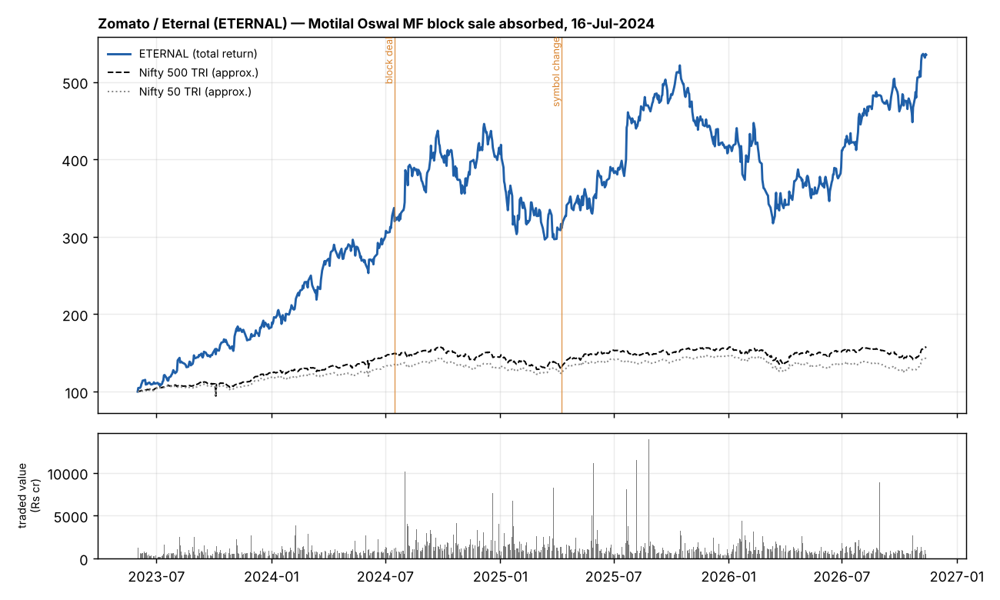

# Zomato / Eternal (ETERNAL) — Motilal Oswal MF block sale absorbed, 16-Jul-2024

_All figures computed from NSE archive data in this repository unless marked as news/user-provided. Entry = close of the first NSE session strictly after the disclosure. Returns are total returns (dividends on ex-date) vs approximate TRI benchmarks._

## 1. Event timeline and verification

| date | type | description | price (Rs) | verification | buyer classification (rule-based) |
|---|---|---|---|---|---|
| 2024-07-16 | block_deal | Motilal Oswal MF sold ~2.84 crore shares (~0.3%) of Zomato, ~Rs 646 crore | 226.85 | verified by multiple news reports; user brief lists Citigroup, Goldman Sachs, Morgan Stanley, Polar, Axis MF, SocGen (consistent) | Societe Generale: arbitrage_desk (medium) Axis MF: domestic_mf (medium) BNP Paribas Arbitrage: arbitrage_desk (high) Citigroup Global Markets Mauritius: arbitrage_desk (high) Goldman Sachs: broker_dealer (low) Matthews Asia: foreign_mutual_fund (medium) Morgan Stanley: broker_dealer (low) Optimas Capital: unknown (low) Polar Capital: foreign_mutual_fund (medium) |
| 2025-04-09 | symbol_change | ZOMATO renamed ETERNAL |  | verified: NSE symbolchange.csv |  |

**Exchange footprint of block days (NSE bhavcopy + delivery):**

| date | close | day return | volume / 126d median | delivery % | traded value (Rs cr) |
|---|---|---|---|---|---|
| 2024-07-16 | 217.49 | -5.1% | 1.0x | 51.7 | 991 |

## 2. Quarterly ownership (NSE SHP XBRL, point-in-time)

| quarter | available (broadcast) | promoter % | FII (FPI) % | MF % | insurance % | total inst % | Δ FII pp | Δ MF pp | Δ inst pp | share-count chg (ex-split) |
|---|---|---|---|---|---|---|---|---|---|---|
| 2021-09-30 | 2022-01-07 | 0.00 | 9.87 | 4.40 | 0.17 | 15.00 | +nan | +nan | +nan | n/a |
| 2021-12-31 | 2022-01-19 | 0.00 | 11.04 | 3.88 | 0.39 | 15.68 | +1.17 | -0.52 | +0.68 | 0.33% |
| 2022-03-31 | 2022-04-20 | 0.00 | 10.17 | 2.82 | 0.12 | 13.49 | -0.87 | -1.06 | -2.19 | 0.01% |
| 2022-06-30 | 2022-07-20 | 0.00 | 9.85 | 2.37 | 0.19 | 12.60 | -0.32 | -0.45 | -0.89 | 0.02% |
| 2022-09-30 | 2022-10-21 | 0.00 | 25.46 | 4.57 | 1.16 | 31.86 | +15.61 | +2.20 | +19.26 | 8.57% |
| 2022-12-31 | 2023-01-20 | 0.00 | 31.74 | 5.59 | 1.10 | 39.16 | +6.28 | +1.02 | +7.30 | 0.04% |
| 2023-03-31 | 2023-04-20 | 0.00 | 31.63 | 6.40 | 0.77 | 39.67 | -0.11 | +0.81 | +0.51 | 0.02% |
| 2023-06-30 | 2023-07-21 | 0.00 | 33.33 | 8.30 | 0.83 | 43.26 | +1.70 | +1.90 | +3.59 | 0.30% |
| 2023-09-30 | 2023-10-18 | 0.00 | 37.64 | 10.56 | 1.52 | 50.68 | +4.31 | +2.26 | +7.42 | 0.29% |
| 2023-12-31 | 2024-01-15 | 0.00 | 42.83 | 12.34 | 2.06 | 58.31 | +5.19 | +1.78 | +7.63 | 1.24% |
| 2024-03-31 | 2024-04-17 | 0.00 | 47.00 | 11.96 | 2.25 | 62.27 | +4.17 | -0.38 | +3.96 | 1.25% |
| 2024-06-30 | 2024-07-19 | 0.00 | 46.13 | 12.52 | 2.18 | 61.92 | -0.87 | +0.56 | -0.35 | 0.08% |
| 2024-09-30 | 2024-10-14 | 0.00 | 47.28 | 13.57 | 2.41 | 64.61 | +1.15 | +1.05 | +2.69 | 0.08% |
| 2024-12-31 | 2025-01-13 | 0.00 | 43.20 | 16.42 | 2.49 | 63.72 | -4.08 | +2.85 | -0.89 | 9.24% |
| 2025-03-31 | 2025-04-07 | 0.00 | 40.27 | 19.37 | 2.15 | 63.81 | -2.93 | +2.95 | +0.09 | 0.00% |
| 2025-06-30 | 2025-07-14 | nan | 38.31 | 21.59 | 2.80 | 64.90 | -1.96 | +2.22 | +1.09 | 0.00% |
| 2025-09-30 | 2025-10-13 | nan | 37.10 | 24.68 | 3.03 | 67.20 | -1.21 | +3.09 | +2.30 | 0.00% |
| 2025-12-31 | 2026-01-12 | nan | 34.39 | 26.72 | 3.43 | 67.10 | -2.71 | +2.04 | -0.10 | 0.00% |
| 2026-03-31 | 2026-04-03 | nan | 30.84 | 28.91 | 3.83 | 66.83 | -3.55 | +2.19 | -0.27 | 0.00% |
| 2026-06-30 | 2026-07-08 | nan | 27.44 | 31.68 | 4.21 | 66.75 | -3.40 | +2.77 | -0.08 | 0.00% |
| 2026-09-30 | 2026-10-13 | nan | 31.46 | 28.74 | 4.09 | 67.67 | +4.02 | -2.94 | +0.92 | 0.00% |

**Named holders >1% (family level, excl. promoter group), % of equity:**

| family                             | category            |   2021-09 |   2021-12 |   2022-03 |   2022-06 |   2022-09 |   2022-12 |   2023-03 |   2023-06 |   2023-09 |   2023-12 |   2024-03 |   2024-06 |   2024-09 |   2024-12 |   2025-03 |   2025-06 |   2025-09 |   2025-12 |   2026-03 |   2026-06 |   2026-09 |
|:-----------------------------------|:--------------------|----------:|----------:|----------:|----------:|----------:|----------:|----------:|----------:|----------:|----------:|----------:|----------:|----------:|----------:|----------:|----------:|----------:|----------:|----------:|----------:|----------:|
| ADITYA BIRLA SUN LIFE MF           | domestic_mf         |      0    |      0    |      0    |      0    |      0    |      0    |      0    |      0    |      0    |      0    |      0    |      0    |      0    |      0    |      0    |      0    |      1.18 |      1.21 |      1.27 |      1.29 |      1.17 |
| ALIPAY SINGAPORE HOLDING           | pe_vc_strategic     |      0    |      0    |      0    |      0    |      6.54 |      3.46 |      3.46 |      3.45 |      3.44 |      0    |      0    |      0    |      0    |      0    |      0    |      0    |      0    |      0    |      0    |      0    |      0    |
| ALIPAY SINGAPORE HOLDING           | unknown             |      7.12 |      7.1  |      7.1  |      7.1  |      0    |      0    |      0    |      0    |      0    |      0    |      0    |      0    |      0    |      0    |      0    |      0    |      0    |      0    |      0    |      0    |      0    |
| ANTFIN SINGAPORE HOLDING           | pe_vc_strategic     |      7.01 |      6.99 |      6.99 |      6.99 |      6.44 |      6.43 |      6.43 |      6.41 |      6.39 |      6.32 |      4.24 |      4.24 |      2.13 |      1.95 |      1.95 |      1.95 |      0    |      0    |      0    |      0    |      0    |
| AXIS MF                            | domestic_mf         |      0    |      0    |      0    |      0    |      0    |      0    |      0    |      0    |      1.33 |      1.42 |      1.3  |      0    |      1.42 |      1.57 |      1.28 |      1.43 |      1.75 |      1.73 |      1.57 |      1.95 |      1.87 |
| BNP PARIBAS ARBITRAGE ODI          | arbitrage_desk      |      0    |      0    |      0    |      0    |      0    |      0    |      0    |      0    |      1.2  |      0    |      0    |      0    |      0    |      0    |      0    |      0    |      0    |      0    |      0    |      0    |      0    |
| CANARA ROBECO MF                   | domestic_mf         |      0    |      0    |      0    |      0    |      0    |      0    |      0    |      0    |      0    |      0    |      0    |      0    |      0    |      0    |      0    |      0    |      0    |      0    |      0    |      1.05 |      0    |
| CPP INVESTMENTS                    | foreign_pension     |      0    |      0    |      0    |      0    |      0    |      2.31 |      2.33 |      2.37 |      2.01 |      1.83 |      1.69 |      1.33 |      1.15 |      0    |      0    |      0    |      0    |      0    |      0    |      0    |      0    |
| D1 CAPITAL PARTNERS MASTER         | pe_vc_strategic     |      3.25 |      3.24 |      3.24 |      3.24 |      0    |      0    |      0    |      0    |      0    |      0    |      0    |      0    |      0    |      0    |      0    |      0    |      0    |      0    |      0    |      0    |      0    |
| DEEPINDER GOYAL                    | unknown             |      4.71 |      4.69 |      4.69 |      4.69 |      4.32 |      4.32 |      4.32 |      4.31 |      4.29 |      4.24 |      4.19 |      4.19 |      4.18 |      3.83 |      3.83 |      3.83 |      3.83 |      3.83 |      4.4  |      4.4  |      4.4  |
| DELIVERY HERO SE                   | unknown             |      1.37 |      1.36 |      1.36 |      1.36 |      0    |      0    |      0    |      0    |      0    |      0    |      0    |      0    |      0    |      0    |      0    |      0    |      0    |      0    |      0    |      0    |      0    |
| DF INTERNATIONAL PARTNERS II       | unknown             |      0    |      0    |      0    |      0    |      0    |      0    |      0    |      0    |      0    |      0    |      0    |      0    |      0    |      0    |      1.34 |      1.54 |      1.54 |      1.54 |      1.53 |      0    |      0    |
| FIDELITY                           | foreign_mutual_fund |      0    |      0    |      0    |      0    |      2.45 |      2.21 |      1.47 |      1.7  |      1.38 |      1.56 |      1.27 |      1.05 |      1    |      0    |      0    |      0    |      0    |      0    |      0    |      0    |      0    |
| FOODIE BAY EMPLOYEES ESOP          | unknown             |      3.57 |      2.97 |      2.91 |      2.81 |      2.48 |      2.26 |      0    |      2.09 |      1.82 |      1.66 |      1.58 |      1.45 |      1.27 |      6.07 |      5.98 |      5.91 |      5.71 |      5.58 |      4.73 |      4.61 |      4.53 |
| FOODIEBAY EMPLOYEES ESOP TRUST     | unknown             |      0    |      0    |      0    |      0    |      0    |      0    |      2.22 |      0    |      0    |      0    |      0    |      0    |      0    |      0    |      0    |      0    |      0    |      0    |      0    |      0    |      0    |
| FRANKLIN TEMPLETON INDIA MF        | domestic_mf         |      0    |      0    |      0    |      0    |      0    |      0    |      0    |      0    |      0    |      0    |      1    |      1.02 |      0    |      0    |      0    |      0    |      0    |      0    |      0    |      0    |      0    |
| GIC (SINGAPORE)                    | sovereign_wealth    |      0    |      0    |      0    |      0    |      0    |      0    |      0    |      0    |      0    |      1.09 |      1.92 |      2.02 |      1.96 |      1.37 |      1.13 |      1.04 |      0    |      0    |      1.11 |      0    |      1.18 |
| GLADE BROOK INVESTORS XVII         | unknown             |      1.11 |      1.11 |      1.11 |      1.11 |      0    |      0    |      0    |      0    |      0    |      0    |      0    |      0    |      0    |      0    |      0    |      0    |      0    |      0    |      0    |      0    |      0    |
| HDFC MF                            | domestic_mf         |      0    |      0    |      0    |      0    |      0    |      0    |      0    |      0    |      0    |      0    |      0    |      0    |      0    |      0    |      1.48 |      1.59 |      1.78 |      2.19 |      3.53 |      4.31 |      4.12 |
| ICICI PRUDENTIAL MF                | domestic_mf         |      0    |      0    |      0    |      0    |      0    |      0    |      1.18 |      1.2  |      1.24 |      1.26 |      1.03 |      1.29 |      1.17 |      1.75 |      1.78 |      1.99 |      1.85 |      2.17 |      2.64 |      3.01 |      2.41 |
| INFO EDGE (INDIA)                  | pe_vc_strategic     |     15.23 |     15.18 |     15.18 |      0    |     13.98 |     13.97 |     13.97 |     13.93 |     13.88 |     13.71 |     13.55 |     13.53 |     13.52 |     12.38 |     12.38 |     12.38 |     12.38 |     12.38 |     12.38 |     12.38 |     12.38 |
| INFO EDGE INDIA                    | pe_vc_strategic     |      0    |      0    |      0    |     15.17 |      0    |      0    |      0    |      0    |      0    |      0    |      0    |      0    |      0    |      0    |      0    |      0    |      0    |      0    |      0    |      0    |      0    |
| INTERNET FUND III                  | unknown             |      0    |      0    |      0    |      0    |      1.44 |      1.44 |      1.44 |      1.44 |      0    |      0    |      0    |      0    |      0    |      0    |      0    |      0    |      0    |      0    |      0    |      0    |      0    |
| INTERNET FUND VI                   | unknown             |      5.13 |      5.11 |      5.11 |      5.11 |      0    |      0    |      0    |      0    |      0    |      0    |      0    |      0    |      0    |      0    |      0    |      0    |      0    |      0    |      0    |      0    |      0    |
| INVESCO INDIA ARBITRAGE FUND       | arbitrage_desk      |      0    |      0    |      0    |      0    |      0    |      0    |      0    |      0    |      0    |      0    |      0    |      0    |      0    |      0    |      0    |      0    |      1.07 |      1.04 |      0    |      0    |      0    |
| INVESCO INDIA MF                   | domestic_mf         |      0    |      0    |      0    |      0    |      0    |      0    |      0    |      0    |      0    |      0    |      0    |      0    |      0    |      0    |      0    |      0    |      0    |      0    |      0    |      1.08 |      1.02 |
| KORA HOLDINGS II (C)               | pe_vc_strategic     |      0    |      0    |      0    |      0    |      1.22 |      0    |      0    |      0    |      0    |      0    |      0    |      0    |      0    |      0    |      0    |      0    |      0    |      0    |      0    |      0    |      0    |
| KORA HOLDINGS II (C)               | unknown             |      0    |      0    |      1.84 |      1.84 |      0    |      0    |      0    |      0    |      0    |      0    |      0    |      0    |      0    |      0    |      0    |      0    |      0    |      0    |      0    |      0    |      0    |
| KORA HOLDINGS II C                 | unknown             |      1.85 |      1.84 |      0    |      0    |      0    |      0    |      0    |      0    |      0    |      0    |      0    |      0    |      0    |      0    |      0    |      0    |      0    |      0    |      0    |      0    |      0    |
| KORA INVESTMENTS I                 | pe_vc_strategic     |      0    |      0    |      0    |      0    |      1.67 |      1.67 |      1.32 |      1.32 |      0    |      0    |      0    |      0    |      0    |      0    |      0    |      0    |      0    |      0    |      0    |      0    |      0    |
| KORA INVESTMENTS I                 | unknown             |      2.16 |      2.15 |      2.15 |      2.15 |      0    |      0    |      0    |      0    |      0    |      0    |      0    |      0    |      0    |      0    |      0    |      0    |      0    |      0    |      0    |      0    |      0    |
| KOTAK MF                           | domestic_mf         |      0    |      0    |      0    |      0    |      0    |      0    |      0    |      0    |      0    |      1.16 |      1.39 |      1.51 |      1.62 |      1.63 |      1.77 |      2.5  |      2.73 |      2.73 |      2.68 |      3.02 |      2.59 |
| KUWAIT INVESTMENT AUTHORITY        | sovereign_wealth    |      0    |      0    |      0    |      0    |      0    |      0    |      0    |      0    |      1.02 |      1.09 |      1.26 |      1.28 |      1.21 |      1.09 |      1.08 |      0    |      0    |      0    |      0    |      0    |      0    |
| MACRITCHIE INVESTMENTS             | pe_vc_strategic     |      0    |      0    |      0    |      0    |      2.86 |      2.86 |      2.86 |      2.85 |      1.85 |      1.83 |      0    |      0    |      0    |      0    |      0    |      0    |      0    |      0    |      0    |      0    |      0    |
| MACRITCHIE INVESTMENTS             | unknown             |      3.12 |      3.11 |      3.11 |      3.11 |      0    |      0    |      0    |      0    |      0    |      0    |      0    |      0    |      0    |      0    |      0    |      0    |      0    |      0    |      0    |      0    |      0    |
| MIRAE ASSET MF                     | domestic_mf         |      0    |      0    |      0    |      0    |      1.51 |      1.58 |      1.83 |      1.46 |      1.46 |      0    |      0    |      0    |      0    |      0    |      1.12 |      0    |      0    |      1.23 |      1.42 |      0    |      0    |
| MOTILAL OSWAL MF                   | domestic_mf         |      0    |      0    |      0    |      0    |      0    |      0    |      0    |      2.13 |      1.88 |      1.83 |      0    |      1.32 |      0    |      0    |      0    |      0    |      2.13 |      1.71 |      1.77 |      1.83 |      1.71 |
| NIPPON INDIA MF                    | domestic_mf         |      0    |      0    |      0    |      0    |      0    |      0    |      0    |      1.2  |      1.27 |      1.33 |      1.22 |      1.1  |      0    |      1.02 |      0    |      0    |      0    |      0    |      0    |      0    |      0    |
| NIPPON LIFE INDIA TRUSTEE          | etf_passive         |      0    |      0    |      0    |      0    |      0    |      0    |      0    |      0    |      0    |      0    |      0    |      0    |      0    |      0    |      1.49 |      1.56 |      1.72 |      1.76 |      2.03 |      2.55 |      2.28 |
| NORGES BANK                        | sovereign_wealth    |      0    |      0    |      0    |      0    |      0    |      0    |      0    |      0    |      0    |      0    |      1.14 |      1.02 |      1.17 |      0    |      1.12 |      0    |      1.12 |      1.5  |      0    |      0    |      1.01 |
| NPS TRUST                          | foreign_pension     |      0    |      0    |      0    |      0    |      0    |      0    |      0    |      0    |      0    |      0    |      0    |      0    |      0    |      0    |      1.11 |      1.15 |      1.41 |      1.59 |      1.84 |      1.87 |      1.88 |
| SBI BSE SENSEX ETF                 | etf_passive         |      0    |      0    |      0    |      0    |      0    |      0    |      0    |      0    |      0    |      0    |      0    |      0    |      0    |      1.34 |      0    |      0    |      0    |      0    |      0    |      0    |      0    |
| SBI LIFE INSURANCE                 | insurance           |      0    |      0    |      0    |      0    |      0    |      0    |      0    |      0    |      0    |      0    |      0    |      0    |      0    |      0    |      0    |      0    |      0    |      0    |      0    |      1.14 |      1.19 |
| SBI NIFTY 50 ETF                   | etf_passive         |      0    |      0    |      0    |      0    |      0    |      0    |      0    |      0    |      0    |      0    |      0    |      0    |      0    |      0    |      2.43 |      3.36 |      3.3  |      3.59 |      3.54 |      3.64 |      3.48 |
| SCI GROWTH INVESTMENTS II          | pe_vc_strategic     |      0    |      0    |      0    |      0    |      3.1  |      1.32 |      1.32 |      0    |      0    |      0    |      0    |      0    |      0    |      0    |      0    |      0    |      0    |      0    |      0    |      0    |      0    |
| SCI GROWTH INVESTMENTS II          | unknown             |      5.12 |      5.1  |      5.1  |      5.1  |      0    |      0    |      0    |      0    |      0    |      0    |      0    |      0    |      0    |      0    |      0    |      0    |      0    |      0    |      0    |      0    |      0    |
| SOFTBANK                           | pe_vc_strategic     |      0    |      0    |      0    |      0    |      3.36 |      3.36 |      3.36 |      3.35 |      2.17 |      0    |      0    |      0    |      0    |      0    |      0    |      0    |      0    |      0    |      0    |      0    |      0    |
| TEMASEK                            | sovereign_wealth    |      2.18 |      2.18 |      2.18 |      2.18 |      2    |      3.17 |      3.97 |      3.96 |      3.94 |      3.9  |      3.85 |      3.84 |      3.84 |      2.87 |      2.87 |      2.87 |      2.87 |      2.87 |      2.87 |      2.87 |      2.87 |
| UBER B V                           | unknown             |      7.8  |      7.78 |      7.78 |      7.78 |      0    |      0    |      0    |      0    |      0    |      0    |      0    |      0    |      0    |      0    |      0    |      0    |      0    |      0    |      0    |      0    |      0    |
| UTI MF                             | domestic_mf         |      0    |      0    |      0    |      0    |      0    |      0    |      0    |      0    |      0    |      0    |      0    |      0    |      0    |      1.31 |      1.75 |      1.61 |      1.75 |      1.99 |      2.15 |      2.3  |      2.07 |
| VANGUARD EMERGING MARKETS STOCK    | etf_passive         |      0    |      0    |      0    |      0    |      0    |      0    |      0    |      0    |      0    |      0    |      1.03 |      1.03 |      0    |      0    |      0    |      0    |      0    |      0    |      0    |      0    |      0    |
| VANGUARD TOTAL INTERNATIONAL STOCK | etf_passive         |      0    |      0    |      0    |      0    |      0    |      0    |      0    |      0    |      0    |      0    |      1.06 |      1.08 |      1.08 |      0    |      1.1  |      0    |      0    |      0    |      0    |      0    |      0    |
| VY INVESTMENTS MAURITIUS           | pe_vc_strategic     |      0    |      0    |      0    |      0    |      1.96 |      1.96 |      1.96 |      1.57 |      0    |      0    |      0    |      0    |      0    |      0    |      0    |      0    |      0    |      0    |      0    |      0    |      0    |
| VY INVESTMENTS MAURITIUS           | unknown             |      2.14 |      2.13 |      2.13 |      2.13 |      0    |      0    |      0    |      0    |      0    |      0    |      0    |      0    |      0    |      0    |      0    |      0    |      0    |      0    |      0    |      0    |      0    |
| VYC20                              | pe_vc_strategic     |      0    |      0    |      0    |      0    |      1.62 |      0    |      0    |      0    |      0    |      0    |      0    |      0    |      0    |      0    |      0    |      0    |      0    |      0    |      0    |      0    |      0    |
| VYC20                              | unknown             |      1.77 |      1.76 |      1.76 |      1.76 |      0    |      0    |      0    |      0    |      0    |      0    |      0    |      0    |      0    |      0    |      0    |      0    |      0    |      0    |      0    |      0    |      0    |

## 3. Fundamentals and when they became public (Yahoo annual data — supplementary; availability from NSE board-meeting dates)

| FY end | available from | revenue (Rs cr) | EBITDA (Rs cr) | PAT (Rs cr) | rev growth | EBITDA margin | PAT growth | ROCE |
|---|---|---|---|---|---|---|---|---|
| 2023-03-31 | 2023-05-20 | 7,035 | -532 | -971 | n/a | -7.6% | n/a | -9.2% |
| 2024-03-31 | 2024-05-14 | 12,114 | 886 | 351 | 72.2% | 7.3% | 136.1% | 2.0% |
| 2025-03-31 | 2025-05-31 | 20,243 | 1,711 | 527 | 67.1% | 8.5% | 50.1% | 3.4% |
| 2026-03-31 | 2026-04-29 | 54,364 | 2,600 | 366 | 168.6% | 4.8% | -30.6% | 3.7% |

**Results-announcement reactions (3-session abnormal return vs Nifty 500):**

| board meeting | reaction |
|---|---|
| 2021-08-10 | 4.3% |
| 2021-11-10 | 3.2% |
| 2022-02-10 | -5.0% |
| 2023-02-09 | -1.8% |
| 2023-05-19 | -0.9% |
| 2023-08-03 | 12.0% |
| 2023-11-03 | -1.5% |
| 2024-02-08 | 7.2% |
| 2024-05-13 | -8.0% |
| 2024-08-01 | 15.5% |
| 2024-10-22 | 1.2% |
| 2025-01-20 | -12.6% |
| 2025-07-21 | 16.4% |
| 2025-10-16 | -4.3% |
| 2026-01-21 | 2.1% |
| 2026-04-28 | -0.8% |
| 2026-07-22 | 1.8% |
| 2026-10-21 | -3.4% |

## 4. Forward returns from each disclosure (entry at next session close)

| trigger | entry date | entry close | 1m | 3m | 6m | 12m | to date | Nifty 500 to date | segment index to date |
|---|---|---|---|---|---|---|---|---|---|
| Block deal disclosed (16-Jul-2024, Rs 226.85) | 2024-07-18 | 220.62 | +19.9% (+20.4 vs N500) | +16.7% (+15.4 vs N500) | +12.8% (+18.9 vs N500) | +16.6% (+15.2 vs N500) | 64.8% | 5.0% | 4.5% |
| Jun-2024 SHP broadcast (19-Jul-2024) | 2024-07-22 | 221.66 | +16.4% (+14.1 vs N500) | +15.7% (+15.9 vs N500) | -2.4% (+3.9 vs N500) | +35.3% (+32.4 vs N500) | 64.1% | 6.2% | 5.7% |
| Month-end scanner rebalance (31-Jul-2024) | 2024-08-01 | 234.09 | +7.0% (+6.0 vs N500) | +6.4% (+9.0 vs N500) | +1.0% (+8.6 vs N500) | +30.2% (+32.6 vs N500) | 55.3% | 3.6% | 3.5% |

## 5. Return decomposition: earnings growth vs re-rating

log(price return) = log(fundamental growth) + log(multiple change) − log(share-count growth); fundamentals = latest FY figures public at each date.

| entry | horizon end | basis | FY at entry→exit | fundamental entry→exit (Rs cr) | multiple entry→exit | price return | from fundamentals | from multiple |
|---|---|---|---|---|---|---|---|---|
| 2024-07-18 | 2025-07-18 | P/E | 2024-03→2025-03 | 351→527 | 554.4→471.0 | 16.6% | +0.41 log pts | -0.16 log pts |
| 2024-07-18 | 2026-11-13 | P/E | 2024-03→2026-03 | 351→366 | 554.4→958.8 | 64.8% | +0.04 log pts | +0.55 log pts |
| 2024-07-22 | 2025-07-22 | P/E | 2024-03→2025-03 | 351→527 | 557.4→549.0 | 35.3% | +0.41 log pts | -0.02 log pts |
| 2024-07-22 | 2026-11-13 | P/E | 2024-03→2026-03 | 351→366 | 557.4→958.8 | 64.1% | +0.04 log pts | +0.54 log pts |
| 2024-08-01 | 2025-08-01 | P/E | 2024-03→2025-03 | 351→527 | 588.7→558.1 | 30.2% | +0.41 log pts | -0.05 log pts |
| 2024-08-01 | 2026-11-13 | P/E | 2024-03→2026-03 | 351→366 | 588.7→958.8 | 55.3% | +0.04 log pts | +0.49 log pts |

## 6. What the scanner saw at each month-end (scores 0-100; rank among eligible stocks)

| date       | eligible   | segment   |   mcap_rank |   score_B_shareholding |   score_A_block |   score_earnings |   score_D_inst_block_earnings |   score_E_full |   rank_D |   rank_E |   d_fii_1q |   d_mf_1q |   d_inst_1q |   nh_credible_increase_pp | absorption_event   |   ear |
|:-----------|:-----------|:----------|------------:|-----------------------:|----------------:|-----------------:|------------------------------:|---------------:|---------:|---------:|-----------:|----------:|------------:|--------------------------:|:-------------------|------:|
| 2023-06-30 | True       | large     |          85 |                  77.79 |           53.68 |            40.35 |                         57.27 |          37.99 |      198 |      623 |      -0.11 |      0.81 |        0.51 |                      2.25 | False              | -0.01 |
| 2023-07-31 | True       | large     |          81 |                  90.74 |           59.65 |            40.7  |                         63.7  |          41.85 |       88 |      584 |       1.7  |      1.9  |        3.59 |                      3.62 | True               | -0.01 |
| 2023-08-31 | True       | large     |          69 |                  90.71 |           59.96 |            77.69 |                         76.12 |          53.39 |       10 |      274 |       1.7  |      1.9  |        3.59 |                      3.62 | True               |  0.12 |
| 2023-09-29 | True       | large     |          68 |                  90.72 |           60.29 |            77.49 |                         76.17 |          53.57 |        7 |      267 |       1.7  |      1.9  |        3.59 |                      3.62 | True               |  0.12 |
| 2023-10-31 | True       | large     |          62 |                  95.11 |           51.89 |            77.78 |                         74.93 |          53.1  |       11 |      286 |       4.31 |      2.26 |        7.42 |                      2.46 | True               |  0.12 |
| 2023-11-30 | True       | large     |          59 |                  95.05 |           52.2  |            42.55 |                         63.27 |          42.58 |       91 |      565 |       4.31 |      2.26 |        7.42 |                      2.46 | True               | -0.02 |
| 2023-12-29 | True       | large     |          66 |                  94.96 |           52.92 |            42.4  |                         63.42 |          42.51 |       89 |      566 |       4.31 |      2.26 |        7.42 |                      2.46 | True               | -0.02 |
| 2024-01-31 | True       | large     |          60 |                  96.05 |           70.28 |            42.64 |                         69.65 |          45.61 |       27 |      511 |       5.19 |      1.78 |        7.63 |                      2.67 | True               | -0.02 |
| 2024-02-29 | True       | large     |          49 |                  96.14 |           70.53 |            79.85 |                         82.17 |          57.99 |        2 |      154 |       5.19 |      1.78 |        7.63 |                      2.67 | True               |  0.07 |
| 2024-03-28 | True       | large     |          45 |                  96.15 |           70.76 |            79.66 |                         82.19 |          58.14 |        2 |      152 |       5.19 |      1.78 |        7.63 |                      2.67 | True               |  0.07 |
| 2024-04-30 | True       | large     |          47 |                  81.41 |           60.56 |            79.41 |                         73.79 |          54.33 |       13 |      251 |       4.17 |     -0.38 |        3.96 |                      3.37 | True               |  0.07 |
| 2024-05-31 | True       | large     |          52 |                  81.42 |           60.95 |            65.12 |                         69.17 |          50.79 |       35 |      352 |       4.17 |     -0.38 |        3.96 |                      3.37 | True               | -0.08 |
| 2024-06-28 | True       | large     |          50 |                  81.44 |           59.52 |            65.11 |                         68.69 |          50.64 |       31 |      359 |       4.17 |     -0.38 |        3.96 |                      3.37 | True               | -0.08 |
| 2024-07-31 | True       | large     |          48 |                  45.63 |           61.71 |            64.87 |                         57.4  |          46.8  |      171 |      507 |      -0.87 |      0.56 |       -0.35 |                      1.84 | False              | -0.08 |
| 2024-08-30 | True       | large     |          42 |                  45.33 |           61.67 |            87.52 |                         64.84 |          54.17 |       65 |      231 |      -0.87 |      0.56 |       -0.35 |                      1.84 | False              |  0.15 |
| 2024-09-30 | True       | large     |          41 |                  45.5  |           62.79 |            87.64 |                         65.31 |          54.16 |       59 |      238 |      -0.87 |      0.56 |       -0.35 |                      1.84 | False              |  0.15 |
| 2024-10-31 | True       | large     |          41 |                  71.75 |           58.14 |            78.45 |                         69.45 |          53.49 |       30 |      252 |       1.15 |      1.05 |        2.69 |                      1.68 | True               |  0.01 |
| 2024-11-29 | True       | large     |          33 |                  71.63 |           58.24 |            78.57 |                         69.48 |          54.14 |       23 |      222 |       1.15 |      1.05 |        2.69 |                      1.68 | True               |  0.01 |
| 2024-12-31 | True       | large     |          28 |                  71.79 |           58.87 |            78.68 |                         69.78 |          53.97 |       23 |      217 |       1.15 |      1.05 |        2.69 |                      1.68 | True               |  0.01 |
| 2025-01-31 | True       | large     |          38 |                  37.83 |           49.44 |            60.74 |                         49.34 |          43.72 |      375 |      578 |      -4.08 |      2.85 |       -0.89 |                      3.07 | False              | -0.13 |
| 2025-02-28 | True       | large     |          33 |                  37.85 |           49.27 |            60.91 |                         49.34 |          42.6  |      382 |      600 |      -4.08 |      2.85 |       -0.89 |                      3.07 | False              | -0.13 |
| 2025-03-28 | True       | large     |          40 |                  37.77 |           62    |            60.89 |                         53.55 |          43.22 |      241 |      588 |      -4.08 |      2.85 |       -0.89 |                      3.07 | False              | -0.13 |
| 2025-04-30 | True       | large     |          36 |                  50.85 |           74.29 |            61.16 |                         62.1  |          44.9  |       76 |      560 |      -2.93 |      2.95 |        0.09 |                      5.44 | False              | -0.13 |
| 2025-05-30 | True       | large     |          36 |                  50.9  |           77.03 |            61.11 |                         63.01 |          44.33 |       61 |      570 |      -2.93 |      2.95 |        0.09 |                      5.44 | False              | -0.13 |
| 2025-06-30 | True       | large     |          31 |                  50.96 |           76.89 |            44.78 |                         57.54 |          38.31 |      162 |      679 |      -2.93 |      2.95 |        0.09 |                      5.44 | False              | -0.13 |
| 2025-07-31 | True       | large     |          25 |                  58.64 |           69.09 |            71.03 |                         66.25 |          48.15 |       45 |      465 |      -1.96 |      2.22 |        1.09 |                      1.24 | False              |  0.16 |
| 2025-08-29 | True       | large     |          24 |                  58.75 |           72.44 |            71.12 |                         67.44 |          48.25 |       33 |      458 |      -1.96 |      2.22 |        1.09 |                      1.24 | False              |  0.16 |
| 2025-09-30 | True       | large     |          23 |                  58.72 |           72.81 |            71.08 |                         67.54 |          48.5  |       33 |      450 |      -1.96 |      2.22 |        1.09 |                      1.24 | False              |  0.16 |
| 2025-10-31 | True       | large     |          27 |                  64.41 |           74.38 |            53.93 |                         64.24 |          43.51 |       58 |      596 |      -1.21 |      3.09 |        2.3  |                      5.57 | False              | -0.04 |
| 2025-11-28 | True       | large     |          27 |                  64.44 |           57.59 |            53.92 |                         58.65 |          42.17 |      137 |      619 |      -1.21 |      3.09 |        2.3  |                      5.57 | False              | -0.04 |
| 2025-12-31 | True       | large     |          31 |                  64.43 |           58.13 |            53.86 |                         58.81 |          41.7  |      134 |      621 |      -1.21 |      3.09 |        2.3  |                      5.57 | False              | -0.04 |
| 2026-01-30 | True       | large     |          32 |                  42.06 |           61.27 |            61.47 |                         54.94 |          42.98 |      234 |      601 |      -2.71 |      2.04 |       -0.1  |                      2.79 | False              |  0.02 |
| 2026-02-27 | True       | large     |          39 |                  42.02 |           61.23 |            60.6  |                         54.62 |          41.63 |      228 |      628 |      -2.71 |      2.04 |       -0.1  |                      2.79 | False              |  0.02 |
| 2026-03-30 | True       | large     |          37 |                  42.02 |           60.43 |            60.53 |                         54.33 |          41.59 |      236 |      623 |      -2.71 |      2.04 |       -0.1  |                      2.79 | False              |  0.02 |
| 2026-04-30 | True       | large     |          37 |                  38.98 |           59.87 |            43.18 |                         47.34 |          36.78 |      448 |      699 |      -3.55 |      2.19 |       -0.27 |                      3.64 | False              | -0.01 |
| 2026-05-29 | True       | large     |          40 |                  38.91 |           59.68 |            43.63 |                         47.41 |          36.9  |      454 |      698 |      -3.55 |      2.19 |       -0.27 |                      3.64 | False              | -0.01 |
| 2026-06-30 | True       | large     |          35 |                  39.02 |           59.15 |            43.81 |                         47.32 |          37.59 |      452 |      691 |      -3.55 |      2.19 |       -0.27 |                      3.64 | False              | -0.01 |
| 2026-07-31 | True       | large     |          30 |                  43.91 |           55.15 |            48.93 |                         49.33 |          39.39 |      393 |      674 |      -3.4  |      2.77 |       -0.08 |                      5.4  | False              |  0.02 |
| 2026-08-31 | True       | large     |          29 |                  43.94 |           69.16 |            48.83 |                         53.98 |          41.52 |      250 |      645 |      -3.4  |      2.77 |       -0.08 |                      5.4  | False              |  0.02 |
| 2026-09-30 | True       | large     |          26 |                  43.93 |           70.33 |            48.92 |                         54.39 |          41.85 |      242 |      641 |      -3.4  |      2.77 |       -0.08 |                      5.4  | False              |  0.02 |
| 2026-10-30 | True       | large     |          23 |                  56.1  |           81.5  |            40.53 |                         59.37 |          40.24 |      122 |      671 |       4.02 |     -2.94 |        0.92 |                      2.25 | False              | -0.03 |
| 2026-11-13 | True       | large     |          24 |                  56.21 |           81.49 |            41.55 |                         59.75 |          40.75 |      117 |      656 |       4.02 |     -2.94 |        0.92 |                      2.25 | False              | -0.03 |

