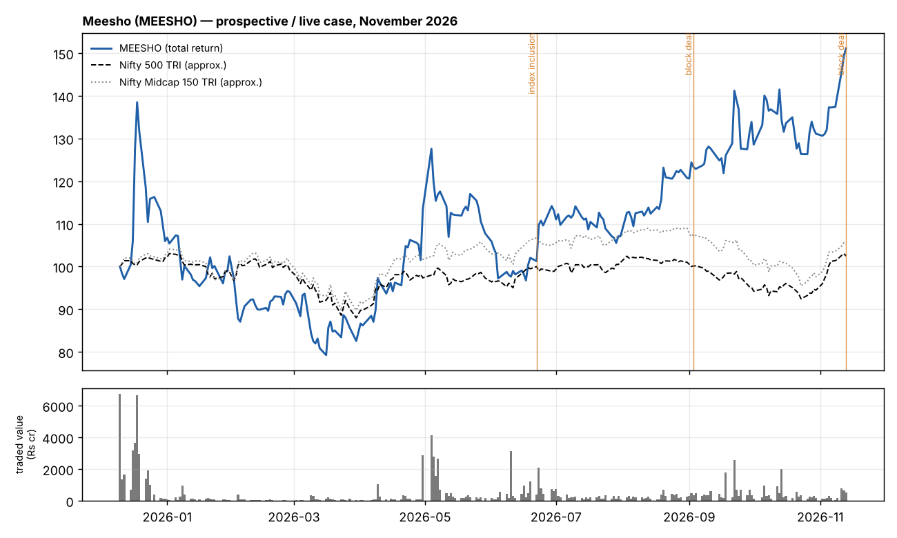

# Meesho (MEESHO) — prospective / live case, November 2026

_All figures computed from NSE archive data in this repository unless marked as news/user-provided. Entry = close of the first NSE session strictly after the disclosure. Returns are total returns (dividends on ex-date) vs approximate TRI benchmarks._

## 1. Event timeline and verification

| date | type | description | price (Rs) | verification | buyer classification (rule-based) |
|---|---|---|---|---|---|
| 2026-09-03 | block_deal | SVF II Meerkat (SoftBank) sold ~8 crore shares (~1.7%), ~Rs 1,650 crore | 206.3 | verified by news; buyer list conflicting | Fidelity, Goldman Sachs, Norges Bank, Morgan Stanley, BofA Securities, Kuwait Investment Authority: sovereign_wealth (high) another report names Franklin Templeton: unknown (low) |
| 2026-11-13 | block_deal | SVF II Meerkat (SoftBank) sold 7.64 crore shares (1.65%), Rs 1,885 crore; holding to 5.19% | 246.75 | verified by news; quantities from single reports | Fidelity: foreign_mutual_fund (high) Societe Generale: arbitrage_desk (medium) Morgan Stanley Asia: broker_dealer (low) Norges Bank: sovereign_wealth (high) other funds: unknown (low) |
| 2026-06-22 | index_inclusion | Added to FTSE All-World / All-Cap (passive demand) |  | verified by news |  |
| 2026-11-24 | index_inclusion | MSCI Global Standard inclusion effective Nov-2026 (user brief) |  | NOT verified: our search found only broker expectations (Centrum), no MSCI announcement; date shown is MSCI's usual end-November effective date |  |

**Exchange footprint of block days (NSE bhavcopy + delivery):**

| date | close | day return | volume / 126d median | delivery % | traded value (Rs cr) |
|---|---|---|---|---|---|
| 2026-09-03 | 209.74 | -0.9% | 1.5x | 32.2 | 363 |
| 2026-11-13 | 257.07 | 1.2% | 1.6x | 49.8 | 534 |

## 2. Quarterly ownership (NSE SHP XBRL, point-in-time)

| quarter | available (broadcast) | promoter % | FII (FPI) % | MF % | insurance % | total inst % | Δ FII pp | Δ MF pp | Δ inst pp | share-count chg (ex-split) |
|---|---|---|---|---|---|---|---|---|---|---|
| 2025-12-31 | 2026-01-20 | 16.76 | 4.31 | 4.56 | 0.16 | 9.59 | +nan | +nan | +nan | n/a |
| 2026-03-31 | 2026-04-10 | 16.57 | 4.17 | 4.91 | 0.07 | 9.72 | -0.14 | +0.35 | +0.13 | 1.13% |
| 2026-06-30 | 2026-07-14 | 16.41 | 5.19 | 8.15 | 0.18 | 14.33 | +1.02 | +3.24 | +4.61 | 0.98% |
| 2026-09-30 | 2026-10-05 | 16.34 | 9.84 | 11.68 | 0.83 | 23.50 | +4.65 | +3.53 | +9.17 | 0.43% |

**Named holders >1% (family level, excl. promoter group), % of equity:**

| family                       | category            |   2025-12 |   2026-03 |   2026-06 |   2026-09 |
|:-----------------------------|:--------------------|----------:|----------:|----------:|----------:|
| ADITYA BIRLA SUN LIFE MF     | domestic_mf         |      0    |      1.43 |      1.62 |      1.91 |
| ASTREND INDIA INVESTMENT     | pe_vc_strategic     |      2.15 |      2.13 |      1.88 |      1.82 |
| ELEVATION CAPITAL V          | pe_vc_strategic     |     12.3  |     12.16 |     12.04 |     10.86 |
| FID FDI 312                  | pe_vc_strategic     |      1.14 |      1.13 |      0    |      0    |
| FIDELITY                     | foreign_mutual_fund |      0    |      0    |      0    |      1.17 |
| HSBC MF (incl. L&T)          | domestic_mf         |      0    |      0    |      0    |      1.23 |
| INVESCO INDIA MF             | domestic_mf         |      0    |      0    |      1.59 |      1.97 |
| MARS EQUITY DRAGON FUND      | pe_vc_strategic     |      1.14 |      1.13 |      1.12 |      1.11 |
| MEESHO                       | unknown             |      1.7  |      1.68 |      0    |      0    |
| MOTILAL OSWAL NIFTY 500      | etf_passive         |      0    |      0    |      0    |      1.01 |
| NASPERS VENTURES BV          | pe_vc_strategic     |     11.51 |     11.38 |     11.27 |     11.22 |
| PEAK XV PARTNERS GROWTH      | pe_vc_strategic     |      1.42 |      1.41 |      1.39 |      1.39 |
| PEAK XV PARTNERS INVESTMENTS | pe_vc_strategic     |     10.28 |     10.16 |     10.06 |      8.89 |
| RPS WOS II                   | pe_vc_strategic     |      1.2  |      1.19 |      1.18 |      0    |
| SBI MF                       | domestic_mf         |      2.74 |      3.12 |      3.01 |      0    |
| SBI NIFTY MIDCAP 150         | etf_passive         |      0    |      0    |      0    |      2.31 |
| SOFTBANK                     | pe_vc_strategic     |      8.78 |      8.68 |      8.6  |      6.84 |
| WESTBRIDGE CROSSOVER FUND    | pe_vc_strategic     |      3.7  |      3.66 |      3.62 |      3.61 |

## 3. Fundamentals and when they became public (Yahoo annual data — supplementary; availability from NSE board-meeting dates)

| FY end | available from | revenue (Rs cr) | EBITDA (Rs cr) | PAT (Rs cr) | rev growth | EBITDA margin | PAT growth | ROCE |
|---|---|---|---|---|---|---|---|---|
| 2023-03-31 | 2023-05-31 | 5,735 | -1,641 | -1,672 | n/a | -28.6% | n/a | -520.9% |
| 2024-03-31 | 2024-05-31 | 7,615 | -263 | -328 | 32.8% | -3.5% | 80.4% | -425.2% |
| 2025-03-31 | 2025-05-31 | 9,390 | -1,414 | -3,942 | 23.3% | -15.1% | -1103.1% | n/a |
| 2026-03-31 | 2026-05-07 | 12,626 | -1,153 | -1,358 | 34.5% | -9.1% | 65.6% | -52.7% |

**Results-announcement reactions (3-session abnormal return vs Nifty 500):**

| board meeting | reaction |
|---|---|
| 2026-01-30 | 0.6% |
| 2026-05-06 | -4.2% |
| 2026-07-23 | -1.4% |
| 2026-10-28 | -0.4% |

## 4. Forward returns from each disclosure (entry at next session close)

| trigger | entry date | entry close | 1m | 3m | 6m | 12m | to date | Nifty 500 to date | segment index to date |
|---|---|---|---|---|---|---|---|---|---|
| Sep-2026 SoftBank block (03-Sep-2026, Rs 206.30) | 2026-09-04 | 209.00 | +4.6% (+10.6 vs N500) | n/a | n/a | n/a | 23.0% | 2.3% | -2.0% |
| Sep-2026 SHP broadcast | 2026-10-06 | 238.22 | -2.0% (-7.8 vs N500) | n/a | n/a | n/a | 7.9% | 7.0% | 3.3% |

## 5. Return decomposition: earnings growth vs re-rating

log(price return) = log(fundamental growth) + log(multiple change) − log(share-count growth); fundamentals = latest FY figures public at each date.

| entry | horizon end | basis | FY at entry→exit | fundamental entry→exit (Rs cr) | multiple entry→exit | price return | from fundamentals | from multiple |
|---|---|---|---|---|---|---|---|---|
| 2026-09-04 | 2026-11-13 | P/S | 2026-03→2026-03 | 12,626→12,626 | 7.6→9.4 | 23.0% | +0.00 log pts | +0.21 log pts |
| 2026-10-06 | 2026-11-13 | P/S | 2026-03→2026-03 | 12,626→12,626 | 8.7→9.4 | 7.9% | +0.00 log pts | +0.08 log pts |

## 6. What the scanner saw at each month-end (scores 0-100; rank among eligible stocks)

| date       | eligible   | segment   |   mcap_rank |   score_B_shareholding |   score_A_block |   score_earnings |   score_D_inst_block_earnings |   score_E_full |   rank_D |   rank_E |   d_fii_1q |   d_mf_1q |   d_inst_1q |   nh_credible_increase_pp | absorption_event   |    ear |
|:-----------|:-----------|:----------|------------:|-----------------------:|----------------:|-----------------:|------------------------------:|---------------:|---------:|---------:|-----------:|----------:|------------:|--------------------------:|:-------------------|-------:|
| 2025-12-31 | False      | nan       |         nan |                 nan    |          nan    |           nan    |                        nan    |         nan    |      nan |      nan |     nan    |    nan    |      nan    |                    nan    |                    | nan    |
| 2026-01-30 | False      | nan       |         nan |                 nan    |          nan    |           nan    |                        nan    |         nan    |      nan |      nan |     nan    |    nan    |      nan    |                    nan    | False              | nan    |
| 2026-02-27 | False      | nan       |         nan |                 nan    |          nan    |           nan    |                        nan    |         nan    |      nan |      nan |     nan    |    nan    |      nan    |                    nan    | False              |   0.01 |
| 2026-03-30 | True       | mid       |         144 |                 nan    |           34.4  |            30.29 |                        nan    |         nan    |      nan |      nan |     nan    |    nan    |      nan    |                    nan    | False              |   0.01 |
| 2026-04-30 | True       | mid       |         124 |                  53.68 |           55.65 |            30.38 |                         46.57 |          35.85 |      471 |      705 |      -0.14 |      0.35 |        0.13 |                      1.81 | False              |   0.01 |
| 2026-05-29 | True       | mid       |         130 |                  53.37 |           55.38 |            53.04 |                         53.93 |          40.48 |      238 |      668 |      -0.14 |      0.35 |        0.13 |                      1.81 | False              |  -0.04 |
| 2026-06-30 | True       | mid       |         127 |                  53.52 |           76.42 |            53.2  |                         61.05 |          40.33 |       90 |      668 |      -0.14 |      0.35 |        0.13 |                      1.81 | False              |  -0.04 |
| 2026-07-31 | True       | mid       |         132 |                  88.33 |           78.37 |            56.49 |                         74.4  |          46.59 |        9 |      529 |       1.02 |      3.24 |        4.61 |                      1.78 | True               |  -0.01 |
| 2026-08-31 | True       | mid       |         126 |                  88.37 |           78.53 |            56.48 |                         74.46 |          47.49 |        6 |      504 |       1.02 |      3.24 |        4.61 |                      1.78 | True               |  -0.01 |
| 2026-09-30 | True       | mid       |         102 |                  88.33 |           74.17 |            56.44 |                         72.98 |          47.54 |        8 |      497 |       1.02 |      3.24 |        4.61 |                      1.78 | True               |  -0.01 |
| 2026-10-30 | True       | mid       |         103 |                  95.13 |           74.36 |            58.15 |                         75.88 |          49.27 |        7 |      406 |       4.65 |      3.53 |        9.17 |                      3.07 | True               |  -0    |
| 2026-11-13 | True       | large     |          92 |                  95.15 |           74.18 |            59.23 |                         76.19 |          49.48 |        7 |      418 |       4.65 |      3.53 |        9.17 |                      3.07 | True               |  -0    |

