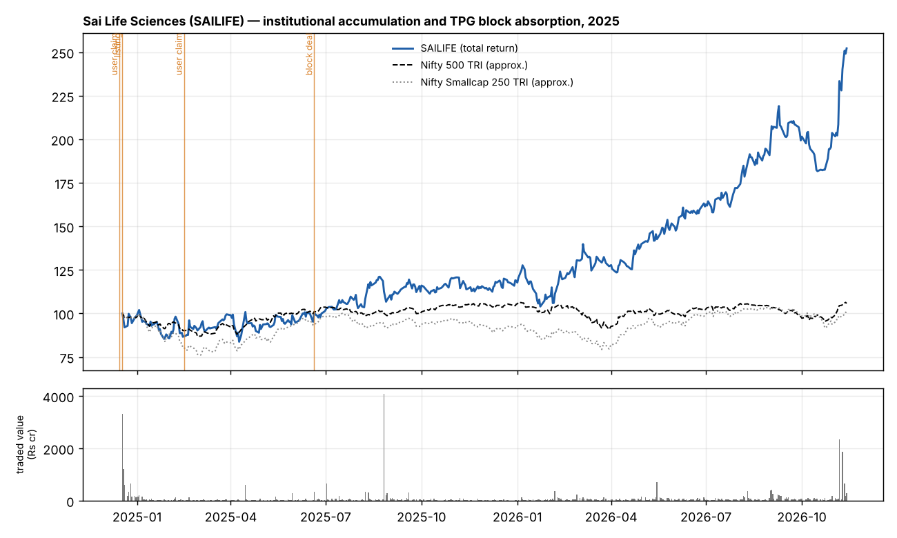

# Sai Life Sciences (SAILIFE) — institutional accumulation and TPG block absorption, 2025

_All figures computed from NSE archive data in this repository unless marked as news/user-provided. Entry = close of the first NSE session strictly after the disclosure. Returns are total returns (dividends on ex-date) vs approximate TRI benchmarks._

## 1. Event timeline and verification

| date | type | description | price (Rs) | verification | buyer classification (rule-based) |
|---|---|---|---|---|---|
| 2024-12-18 | listing | IPO listing on NSE |  | verified: first trade date in NSE bhavcopy |  |
| 2024-12-15 | user_claim | Nippon India MF purchase around Rs 650 (user brief) | 650.0 | partially verified: Nippon India MF named >1% holder in Dec-2024 SHP; deal-level record not retrievable (NSE deal history endpoint inaccessible) |  |
| 2025-02-15 | user_claim | Small Cap World Fund purchase around Rs 685 (user brief) | 685.0 | partially verified: SCWF named holding 1.35% (Dec-2024) -> 2.62% (Mar-2025) in SHP; deal-level record not retrievable |  |
| 2025-06-20 | block_deal | TPG Asia VII SF sold ~2.08 crore shares (~10%) via block deals, ~Rs 1,505 crore | 722.0 | verified by multiple news reports (PTI); buyer-level allocations incomplete; user brief also names ABSL MF (not confirmed) | Nippon India MF: domestic_mf (high) BlackRock: foreign_long_only (low) Societe Generale: arbitrage_desk (medium) Morgan Stanley: broker_dealer (low) Invesco MF: domestic_mf (medium) Norway Government Pension Fund Global: sovereign_wealth (high) others: unknown (low) |

**Exchange footprint of block days (NSE bhavcopy + delivery):**

| date | close | day return | volume / 126d median | delivery % | traded value (Rs cr) |
|---|---|---|---|---|---|
| 2025-06-20 | 765.25 | 5.1% | 10.8x | 48.2 | 330 |

## 2. Quarterly ownership (NSE SHP XBRL, point-in-time)

| quarter | available (broadcast) | promoter % | FII (FPI) % | MF % | insurance % | total inst % | Δ FII pp | Δ MF pp | Δ inst pp | share-count chg (ex-split) |
|---|---|---|---|---|---|---|---|---|---|---|
| 2024-12-31 | 2025-01-20 | 35.24 | 11.72 | 10.19 | 1.06 | 23.67 | +nan | +nan | +nan | n/a |
| 2025-03-31 | 2025-04-17 | 35.17 | 12.36 | 11.54 | 1.31 | 25.62 | +0.64 | +1.35 | +1.95 | 0.20% |
| 2025-06-30 | 2025-07-18 | 35.15 | 14.57 | 18.73 | 2.50 | 36.21 | +2.21 | +7.19 | +10.59 | 0.06% |
| 2025-09-30 | 2025-10-19 | 34.94 | 22.50 | 26.17 | 3.15 | 52.41 | +7.93 | +7.44 | +16.20 | 0.58% |
| 2025-12-31 | 2026-01-20 | 34.70 | 21.41 | 27.57 | 3.24 | 52.82 | -1.09 | +1.40 | +0.41 | 0.71% |
| 2026-03-31 | 2026-04-14 | 34.61 | 21.17 | 27.80 | 3.07 | 52.71 | -0.24 | +0.23 | -0.11 | 0.26% |
| 2026-06-30 | 2026-07-20 | 34.53 | 19.65 | 29.47 | 2.91 | 52.36 | -1.52 | +1.67 | -0.35 | 0.24% |
| 2026-09-30 | 2026-10-07 | 34.50 | 19.91 | 29.56 | 2.65 | 52.23 | +0.26 | +0.09 | -0.13 | 0.06% |

**Named holders >1% (family level, excl. promoter group), % of equity:**

| family                         | category            |   2024-12 |   2025-03 |   2025-06 |   2025-09 |   2025-12 |   2026-03 |   2026-06 |   2026-09 |
|:-------------------------------|:--------------------|----------:|----------:|----------:|----------:|----------:|----------:|----------:|----------:|
| ADITYA BIRLA SUN LIFE MF       | domestic_mf         |      0    |      0    |      1.57 |      2.15 |      2.14 |      2.25 |      2.76 |      2.81 |
| ANITHA RUDRARAJU NANDYALA      | unknown             |      1.73 |      1.73 |      1.69 |      1.66 |      1.64 |      1.6  |      1.55 |      0    |
| AXIS MAX LIFE INSURANCE        | insurance           |      0    |      0    |      1.33 |      1.6  |      1.73 |      1.63 |      1.54 |      1.52 |
| AXIS MF                        | domestic_mf         |      0    |      0    |      1.8  |      3.02 |      3    |      2.94 |      2.9  |      3.19 |
| BLACKROCK                      | foreign_long_only   |      0    |      0    |      0    |      1.03 |      1.07 |      1.3  |      1.12 |      0    |
| CAPITAL GROUP                  | foreign_mutual_fund |      1.35 |      2.62 |      2.62 |      2.6  |      2.58 |      2.58 |      2.57 |      2.57 |
| DSP MF                         | domestic_mf         |      0    |      0    |      0    |      0    |      0    |      0    |      1.06 |      0    |
| GOLDMAN SACHS ASSET MANAGEMENT | foreign_mutual_fund |      1.33 |      1.33 |      1.33 |      1.69 |      1.68 |      1.41 |      1.23 |      1.18 |
| HBM EQUITY INDIA               | pe_vc_strategic     |      1.99 |      1.99 |      1.99 |      0    |      0    |      0    |      0    |      0    |
| HDFC MF                        | domestic_mf         |      0    |      0    |      0    |      1.08 |      1.07 |      1.02 |      0    |      0    |
| HSBC MF (incl. L&T)            | domestic_mf         |      1.25 |      1.12 |      1.12 |      1.92 |      1.91 |      1.86 |      1.86 |      1.86 |
| INVESCO INDIA MF               | domestic_mf         |      2.18 |      2.88 |      4.49 |      7.43 |      7.37 |      7.27 |      7.44 |      7.43 |
| MIRAE ASSET MF                 | domestic_mf         |      0    |      1.19 |      0    |      1.08 |      1.08 |      1.12 |      1.16 |      0    |
| NIPPON INDIA MF                | domestic_mf         |      1.95 |      2.48 |      5.6  |      6.07 |      6.03 |      6.16 |      6.66 |      6.79 |
| PENMASTA ARUNA                 | unknown             |      1.02 |      1.02 |      1.02 |      0    |      1    |      1    |      0    |      0    |
| RAJU PENMASTA                  | unknown             |      1.11 |      1.11 |      1.11 |      0    |      0    |      0    |      0    |      0    |
| TPG                            | pe_vc_strategic     |     24.78 |     24.73 |     14.72 |      0    |      0    |      0    |      0    |      0    |

## 3. Fundamentals and when they became public (Yahoo annual data — supplementary; availability from NSE board-meeting dates)

| FY end | available from | revenue (Rs cr) | EBITDA (Rs cr) | PAT (Rs cr) | rev growth | EBITDA margin | PAT growth | ROCE |
|---|---|---|---|---|---|---|---|---|
| 2023-03-31 | 2023-05-31 | 1,197 | 193 | 10 | n/a | 16.1% | n/a | 5.8% |
| 2024-03-31 | 2024-05-31 | 1,456 | 315 | 83 | 21.7% | 21.6% | 729.0% | 11.4% |
| 2025-03-31 | 2025-05-14 | 1,660 | 442 | 170 | 14.0% | 26.6% | 105.5% | 14.4% |
| 2026-03-31 | 2026-05-15 | 2,137 | 672 | 349 | 28.7% | 31.5% | 105.1% | 19.6% |

**Results-announcement reactions (3-session abnormal return vs Nifty 500):**

| board meeting | reaction |
|---|---|
| 2025-02-06 | 8.7% |
| 2025-05-13 | 6.2% |
| 2025-08-07 | 5.4% |
| 2025-11-06 | -4.5% |
| 2026-02-05 | 5.3% |
| 2026-05-14 | -0.2% |
| 2026-08-06 | -2.0% |
| 2026-11-05 | 12.4% |

## 4. Forward returns from each disclosure (entry at next session close)

| trigger | entry date | entry close | 1m | 3m | 6m | 12m | to date | Nifty 500 to date | segment index to date |
|---|---|---|---|---|---|---|---|---|---|
| Dec-2024 SHP (original submission 20-Jan-2025) | 2025-01-21 | 712.65 | -1.0% (+2.4 vs N500) | +1.3% (-1.7 vs N500) | +13.2% (+3.4 vs N500) | +13.4% (+5.6 vs N500) | 170.7% | 13.1% | 10.3% |
| Mar-2025 SHP broadcast (SCWF 1.35%->2.62%, Nippon up) | 2025-04-21 | 722.00 | +2.6% (-0.8 vs N500) | +11.7% (+5.2 vs N500) | +22.0% (+13.4 vs N500) | +32.8% (+26.9 vs N500) | 167.1% | 9.8% | 15.1% |
| User's entry window start (Apr-2025, ~Rs 650) | 2025-04-02 | 745.25 | -3.9% (-7.5 vs N500) | +5.9% (-5.2 vs N500) | +19.0% (+10.6 vs N500) | +28.8% (+29.2 vs N500) | 158.8% | 13.7% | 19.5% |
| TPG block absorbed (20-Jun-2025, Rs 722) | 2025-06-23 | 754.15 | +8.1% (+6.2 vs N500) | +18.3% (+16.6 vs N500) | +19.6% (+15.1 vs N500) | +61.5% (+60.2 vs N500) | 155.8% | 4.8% | 6.3% |
| Jun-2025 SHP broadcast (block visible in filing) | 2025-07-21 | 806.40 | +14.7% (+15.6 vs N500) | +9.3% (+7.3 vs N500) | +0.2% (+2.0 vs N500) | +59.8% (+58.8 vs N500) | 139.2% | 3.1% | 1.2% |

## 5. Return decomposition: earnings growth vs re-rating

log(price return) = log(fundamental growth) + log(multiple change) − log(share-count growth); fundamentals = latest FY figures public at each date.

| entry | horizon end | basis | FY at entry→exit | fundamental entry→exit (Rs cr) | multiple entry→exit | price return | from fundamentals | from multiple |
|---|---|---|---|---|---|---|---|---|
| 2025-01-21 | 2026-01-21 | P/E | 2024-03→2025-03 | 83→170 | 179.0→100.4 | 13.4% | +0.72 log pts | -0.58 log pts |
| 2025-01-21 | 2026-11-13 | P/E | 2024-03→2026-03 | 83→349 | 179.0→117.4 | 170.7% | +1.44 log pts | -0.42 log pts |
| 2025-04-21 | 2026-04-21 | P/E | 2024-03→2025-03 | 83→170 | 181.7→119.3 | 32.8% | +0.72 log pts | -0.42 log pts |
| 2025-04-21 | 2026-11-13 | P/E | 2024-03→2026-03 | 83→349 | 181.7→117.4 | 167.1% | +1.44 log pts | -0.44 log pts |
| 2025-04-02 | 2026-04-02 | P/E | 2024-03→2025-03 | 83→170 | 187.2→119.2 | 28.8% | +0.72 log pts | -0.45 log pts |
| 2025-04-02 | 2026-11-13 | P/E | 2024-03→2026-03 | 83→349 | 187.2→117.4 | 158.8% | +1.44 log pts | -0.47 log pts |
| 2025-06-23 | 2026-06-23 | P/E | 2025-03→2026-03 | 170→349 | 92.4→73.9 | 61.5% | +0.72 log pts | -0.22 log pts |
| 2025-06-23 | 2026-11-13 | P/E | 2025-03→2026-03 | 170→349 | 92.4→117.4 | 155.8% | +0.72 log pts | +0.24 log pts |
| 2025-07-21 | 2026-07-21 | P/E | 2025-03→2026-03 | 170→349 | 98.8→78.4 | 59.8% | +0.72 log pts | -0.23 log pts |
| 2025-07-21 | 2026-11-13 | P/E | 2025-03→2026-03 | 170→349 | 98.8→117.4 | 139.2% | +0.72 log pts | +0.17 log pts |

## 6. What the scanner saw at each month-end (scores 0-100; rank among eligible stocks)

| date       | eligible   | segment   |   mcap_rank |   score_B_shareholding |   score_A_block |   score_earnings |   score_D_inst_block_earnings |   score_E_full |   rank_D |   rank_E |   d_fii_1q |   d_mf_1q |   d_inst_1q |   nh_credible_increase_pp | absorption_event   |    ear |
|:-----------|:-----------|:----------|------------:|-----------------------:|----------------:|-----------------:|------------------------------:|---------------:|---------:|---------:|-----------:|----------:|------------:|--------------------------:|:-------------------|-------:|
| 2024-12-31 | False      | nan       |         nan |                 nan    |          nan    |           nan    |                        nan    |         nan    |      nan |      nan |     nan    |    nan    |      nan    |                    nan    |                    | nan    |
| 2025-01-31 | False      | nan       |         nan |                 nan    |          nan    |           nan    |                        nan    |         nan    |      nan |      nan |     nan    |    nan    |      nan    |                    nan    | False              | nan    |
| 2025-02-28 | False      | nan       |         nan |                 nan    |          nan    |           nan    |                        nan    |         nan    |      nan |      nan |     nan    |    nan    |      nan    |                    nan    | False              |   0.09 |
| 2025-03-28 | True       | small     |         364 |                 nan    |           38.07 |            78.31 |                        nan    |         nan    |      nan |      nan |     nan    |    nan    |      nan    |                    nan    | False              |   0.09 |
| 2025-04-30 | True       | small     |         385 |                  81.34 |           66.08 |            79.39 |                         75.61 |          60.9  |        2 |       59 |       0.64 |      1.35 |        1.95 |                      3.69 | False              |   0.09 |
| 2025-05-30 | True       | small     |         394 |                  81.36 |           81.32 |            69.43 |                         77.37 |          59.5  |        4 |       73 |       0.64 |      1.35 |        1.95 |                      3.69 | False              |   0.06 |
| 2025-06-30 | True       | small     |         394 |                  81.37 |           84.3  |            69.74 |                         78.47 |          58.74 |        3 |       90 |       0.64 |      1.35 |        1.95 |                      3.69 | False              |   0.06 |
| 2025-07-31 | True       | small     |         380 |                  93.39 |           83.46 |            69.81 |                         82.22 |          60.31 |        1 |       54 |       2.21 |      7.19 |       10.59 |                      9.43 | True               |   0.06 |
| 2025-08-29 | True       | small     |         368 |                  93.48 |           83.65 |            71.09 |                         82.74 |          59.29 |        1 |       65 |       2.21 |      7.19 |       10.59 |                      9.43 | True               |   0.05 |
| 2025-09-30 | True       | small     |         361 |                  93.44 |           83.2  |            70.92 |                         82.52 |          59.44 |        1 |       66 |       2.21 |      7.19 |       10.59 |                      9.43 | True               |   0.05 |
| 2025-10-31 | True       | small     |         347 |                  96.72 |           85.38 |            70.78 |                         84.29 |          60.1  |        1 |       46 |       7.93 |      7.44 |       16.2  |                      9.83 | True               |   0.05 |
| 2025-11-28 | True       | small     |         342 |                  96.74 |           85.8  |            56.59 |                         79.71 |          56.88 |        1 |      119 |       7.93 |      7.44 |       16.2  |                      9.83 | True               |  -0.05 |
| 2025-12-31 | True       | small     |         339 |                  96.71 |           70.06 |            56.62 |                         74.46 |          55.54 |        7 |      157 |       7.93 |      7.44 |       16.2  |                      9.83 | True               |  -0.05 |
| 2026-01-30 | True       | small     |         345 |                  77.65 |           41.8  |            56.83 |                         58.76 |          49.42 |      139 |      389 |      -1.09 |      1.4  |        0.41 |                      0.17 | False              |  -0.05 |
| 2026-02-27 | True       | small     |         317 |                  77.53 |           57.29 |            70.17 |                         68.33 |          54.77 |       29 |      187 |      -1.09 |      1.4  |        0.41 |                      0.17 | False              |   0.05 |
| 2026-03-30 | True       | small     |         308 |                  77.56 |           55.46 |            70.1  |                         67.71 |          54.27 |       31 |      206 |      -1.09 |      1.4  |        0.41 |                      0.17 | False              |   0.05 |
| 2026-04-30 | True       | small     |         317 |                  41.62 |           72.67 |            69.96 |                         61.42 |          51.85 |       82 |      303 |      -0.24 |      0.23 |       -0.11 |                      0.51 | False              |   0.05 |
| 2026-05-29 | True       | small     |         309 |                  41.51 |           71.62 |            67.52 |                         60.22 |          52.81 |       97 |      267 |      -0.24 |      0.23 |       -0.11 |                      0.51 | False              |  -0    |
| 2026-06-30 | True       | small     |         304 |                  41.48 |           57.56 |            67.55 |                         55.53 |          51.93 |      193 |      307 |      -0.24 |      0.23 |       -0.11 |                      0.51 | False              |  -0    |
| 2026-07-31 | True       | small     |         291 |                  41.91 |           54.73 |            68.06 |                         54.9  |          51.82 |      218 |      311 |      -1.52 |      1.67 |       -0.35 |                      2.28 | False              |  -0    |
| 2026-08-31 | True       | small     |         277 |                  41.9  |           55.48 |            61.89 |                         53.09 |          50.39 |      276 |      358 |      -1.52 |      1.67 |       -0.35 |                      2.28 | False              |  -0.02 |
| 2026-09-30 | True       | small     |         263 |                  42.03 |           56.05 |            61.95 |                         53.35 |          50.09 |      270 |      377 |      -1.52 |      1.67 |       -0.35 |                      2.28 | False              |  -0.02 |
| 2026-10-30 | True       | mid       |         250 |                  45.5  |           50.14 |            62.75 |                         52.8  |          49.61 |      268 |      396 |       0.26 |      0.09 |       -0.13 |                      0.47 | False              |  -0.02 |
| 2026-11-13 | True       | mid       |         228 |                  45.65 |           50.13 |            80.79 |                         58.86 |          54.65 |      134 |      181 |       0.26 |      0.09 |       -0.13 |                      0.47 | False              |   0.12 |

