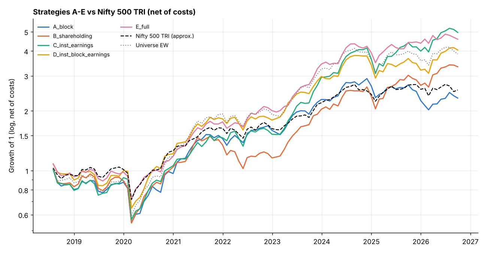

# Institutional Alpha — NSE quantitative research report

*Study period: signals Jul-2018 → Oct-2026 (99 monthly holding periods ending 02-Nov-2026); price data
Jan-2012 → 13-Nov-2026. All results are net of Indian transaction costs unless stated. Every number in
this report is produced by `run_pipeline.py` and can be traced to a file in `outputs/tables/`.*

---

## Executive summary

**The hypothesis, as stated, is not supported.** Quarterly institutional accumulation — FII/FPI
ownership increases, total-institution increases, named long-only funds building >1% stakes, and
institutions absorbing large holders' exits — carries **little or no information about future
returns** in NSE stocks over 2018–2026 once filings are used at their true publication dates.

What *does* predict returns in this data is not institutional ownership but **earnings news and price
momentum**:

| Signal (top-20, equal weight, monthly, net) | CAGR | vs Nifty 500 TRI (t) | vs equal-weight universe (t) |
|---|---|---|---|
| FII ownership increase (1 quarter) | 5.3% | −6.7% (−0.83) | −12.5% (−2.94) |
| Total institutional increase (1 quarter) | 10.1% | −1.9% (−0.02) | −7.7% (−1.62) |
| Mutual-fund ownership increase (1 quarter) | 14.5% | +2.5% (0.73) | −3.3% (−0.84) |
| Named long-only buyers (>1% holders) | 6.8% | −5.2% (−1.09) | −11.0% (−3.76) |
| **B — shareholding accumulation composite** | 15.7% | +3.7% (0.99) | −2.1% (−0.39) |
| Earnings-announcement reaction (proxy) | 26.3% | **+14.3% (2.64)** | **+8.5% (2.10)** |
| 6-month relative strength | 25.3% | +13.3% (1.91) | +7.5% (1.44) |
| **E — full 100-point model** | 20.3% | **+8.3% (2.33)** | +2.5% (0.33) |
| Nifty 500 TRI (approx.) | 12.0% | — | — |
| Equal-weighted eligible universe | 17.8% | — | — |

Key findings:

1. **FII accumulation alone does not predict outperformance** (rank IC ≈ 0.00–0.01, t < 1 at every
   horizon). Two-quarter FII increases are *negatively* related to future returns after controlling for
   momentum (Fama–MacBeth t = −2.7 at 3 months).
2. **Domestic MF accumulation has a small, short-lived edge**: top-minus-bottom quintile +0.9% in the
   month after the filing is published (t = 2.9), ~+1% at 3 months (t = 1.9), gone by 12 months. Too
   small to survive trading costs on its own.
3. **Block-absorption proxies do not work.** Stocks whose large holders (PE, strategic, promoter)
   exited and institutions absorbed it had a median 12-month excess return of −4.4% (hit rate 45%),
   no better than stocks without such events. Named long-only buying is negative after controls
   (t ≈ −2.6). (Historical NSE bulk/block-deal files could not be retrieved — see Limitations.)
4. **Earnings information improves the strategy materially**: adding the earnings component to B lifts
   CAGR from 15.7% to 21.4% (C). The earnings-announcement reaction is the single strongest signal in
   the study (IC 0.054 at 3 months, t = 5.7).
5. **The full model (E) beats the Nifty 500 TRI after costs** (+8.3%/yr, bootstrap 95% CI +1.6% to
   +16.0%, t = 2.3) with lower volatility (19.1% vs 24–26% for A–D) and the smallest drawdown (−33%).
   **But most of that excess is a size/equal-weighting effect:** against the equal-weighted eligible
   universe the excess is +2.5%/yr and not significant.
6. **It is not robust to execution delay.** Entering one month late cuts E from 20.3% to 13.4%; the edge
   sits in the first month after a signal (post-earnings drift and the short-lived MF signal).
7. **Results lean on a few winners**: excluding the ten largest contributors cuts E's CAGR from 20.3% to
   13.8% (+1.8% vs Nifty 500).
8. **Mid and small caps only.** In large caps every strategy trails the Nifty 500; B in large caps
   loses 6.9%/yr (t = −2.4).
9. **Simpler beats optimised.** Walk-forward weight optimisation (24.9% CAGR, 2021+) did worse than the
   fixed 30/25/20/20/5 weights (26.6%) and a two-component institutional + momentum rule (28.0%). The
   optimiser itself kept moving weight *away* from the institutional component (to 0–30%).

**Recommendation:** do not run an "institutional accumulation" strategy as a primary engine. If a
systematic book is wanted, the best-supported variant here is **Strategy E with fixed weights, held as
overlapping 6-month cohorts in mid/small caps** (20.2% CAGR net, +8.2% vs Nifty 500, t = 2.5; costs
≈1.8%/yr instead of 4.5%) — with the explicit understanding that its edge comes from earnings
reactions, momentum and low volatility, that it has not beaten an equal-weighted universe by a
statistically significant margin, and that institutional data should be used as context (e.g. to
flag passive or arbitrage-driven flows), not as the signal.

---

## 1. Hypothesis and research questions

> *Indian stocks experiencing sustained accumulation by credible institutional investors, combined with
> improving business fundamentals and reasonable valuations, are more likely to outperform the broader
> market over the following 3–12 months.*

Tested as an empirical claim, not assumed: does institutional activity, observed only when it becomes
public, contain predictive information about subsequent returns, and do earnings and valuation add to
it? Nine hypothesis questions and twelve critical research questions are answered in §5.

## 2. Data and methodology

### 2.1 What was acquired

| Dataset | Primary source | Coverage used | Size |
|---|---|---|---|
| Daily OHLCV, ISIN, all NSE securities | NSE bhavcopy archive (legacy `cm…bhav.csv.zip` until 05-Jul-2024, UDiFF after) | 02-Jan-2012 → 13-Nov-2026: 3,686 sessions incl. 7 recovered Saturday special sessions | 6.24 m rows, 3,454 symbols |
| Delivery quantity | NSE MTO files | same | 90.2% of rows |
| Corporate actions (dividends, splits, bonuses, consolidations, demergers) | NSE daily PR bundle (`Bc` files) | 2012 → 2026 | 18,679 dividend events; 953 split/bonus factors |
| Results board-meeting dates | NSE PR bundle (`Bm`, `An` files) | 2012 → 2026, **gap Mar–Nov 2022** | 120,682 meetings (106,070 for results) |
| Index closes, P/E, P/B, dividend yield | NSE `ind_close_all` files | Jun-2012 → Nov-2026 | 8 indices |
| Quarterly shareholding patterns: category totals and every named >1% holder | NSE SHP XBRL filings (`nsearchives.nseindia.com/corporate/xbrl/`) | Dec-2017 → Sep-2026 quarters | 32,992 filings, 1,122 symbols, 946k named-holder rows |
| Filing index (URLs, broadcast timestamps), PIT index membership | `aditya-jha/nse-historical-membership` (CC0) | 2014 → 2026 | validated (§2.6) |
| Annual fundamentals | Yahoo Finance fundamentals API (**supplementary**) | FY2023 → FY2026 | 1,124 symbols |
| Case-study block deals | News reports, cited per event | 2024–2026 | 5 events |

Every dataset has a catalogue entry (source URL, retrieval date, coverage, record count,
missingness, quality score, limitations) in `data/metadata/datasets.json`; see
`outputs/reports/Data_Sources_and_Quality.md`.

### 2.2 What could not be acquired, and how each gap is handled

* **Historical bulk/block deals.** NSE serves them only through www.nseindia.com APIs, which refuse
  this environment ("Access Denied" from NSE's CDN); BSE's API host likewise. We did not try to get
  around this. Strategy A is therefore built from two exchange-sourced **proxies**: (i) quarter-on-quarter
  changes of **named >1% holders** in SHP XBRL (who bought, who sold, family-level, classified), and
  (ii) **delivery-backed volume shocks** (≥5× the 126-day median volume, ≥40% delivery, no price
  damage). Case-study block deals come from cited news reports and are checked against the exchange
  footprint and the next SHP filing.
* **Quarterly results XBRL with publication timestamps.** Discovery requires the same blocked APIs. The
  full-period earnings signal is therefore market-based: the **earnings-announcement reaction** (3-session
  abnormal return vs Nifty 500 around each results board meeting). Accounting fundamentals come from
  Yahoo for FY2023–FY2026 only and are used only in tests starting July 2024 (and in the case studies).
  Screener.in was not used: its terms permit personal viewing only.
* **Official TRI series.** Approximated as price index + NSE's published index dividend yield,
  accrued daily. This adds 0.5–1.9 pp/yr to the price index depending on index and year, consistent
  with index dividend yields; it is not validated against the official series.
* **Shareholding of companies delisted before 2026** (e.g. HDFC Ltd, DHFL, Jet Airways) is absent from
  the filings index, so such stocks are never scoreable. Coverage of point-in-time Nifty 500
  constituents with shareholding data: 59% in H2-2018, 93–100% from 2019 (median 96.6%).
* **Pre-2018 shareholding.** NSE's XBRL SHP filings begin with the Dec-2017/Mar-2018 quarters, so
  institutional signals — and every strategy — start in July 2018, not 2012. The development /
  validation / out-of-sample split was shifted accordingly (2018-07..2021-12 / 2022–2023 / 2024-01 on).

### 2.3 Point-in-time rules

* **Timing.** Signal date *t* = last NSE session of the month. Features use only data public at the
  close of *t*; trades execute at the close of the next session; holding returns run close(*t*+1) →
  close(*t′*+1). The institutional deal price is never used as an entry price.
* **Shareholding availability.** A filing is usable from the first session strictly after NSE's
  broadcast timestamp. For 1,167 revised filings broadcast >120 days late, the original submission date
  is used (configurable).
* **Ownership changes are not read as buying blindly.** Changes are measured in percentage points and as
  split-adjusted share flows; quarters with >1% non-split share-count change (QIP, rights, merger, ESOP)
  are flagged; IPO quarters and gaps of more than one quarter are excluded; signals older than ~200
  days are dropped.
* **Category definitions are harmonised across five SEBI XBRL taxonomies.** The 2022 format moved
  "foreign direct investment" holders and NBFCs into the institutions tables; left uncorrected this
  produced a +0.56 pp jump in the average quarterly institutional change exactly at the Sep-2022 switch.
  FII = FPI category I+II (+ foreign SWF line); total institutions = FII + FVCI + domestic institutions
  excluding NBFCs.
* **Universe.** Rebuilt monthly: NSE mainboard EQ/BE, ISIN `INE…`, traded on *t*, ≥60 sessions of
  history, 63-day median traded value ≥ ₹1 crore, top-750 by full market cap (price × filed share count,
  split-adjusted). Segments follow AMFI: ranks 1–100 large, 101–250 mid, 251–750 small. Median 750
  eligible stocks per month (450–550 in 2018–2020). No current index list is used historically.
* **Prices.** NSE's PREVCLOSE field turned out **not** to be adjusted for splits, bonuses or dividends
  (verified: 99.9% of 2,860 large ex-dividend dates, and e.g. Yes Bank's 2017 split, show PREVCLOSE =
  prior close). Adjustment factors are therefore built from NSE corporate-action records, each validated
  against the actual ex-date price jump (953 applied; 415 unrecorded split-like jumps inferred and
  flagged; 108 demerger ex-dates neutralised). Dividends are credited on ex-dates. 19 liquid
  >50% daily moves remain, all genuine events (e.g. Infibeam's 2018 crash, Jet Airways 2019).
* **Delistings.** A stock that stops trading is exited at its last traded close.

### 2.4 Investor classification

Every named >1% holder is mapped by ordered rules to a **family** (the decision-maker: 30 Fidelity
feeder funds count as one buyer) and one of 14 categories — the 13 requested plus
`pe_vc_strategic`, needed because large-holder exits are central to the thesis. Confidence is `high`
for curated entity rules, `medium` for keyword rules, `low` for fallbacks on the SHP table axis.
**Unmatched foreign portfolio investors are classified `unknown`, never long-only.** Goldman Sachs,
Morgan Stanley and Citi entities are classified by legal entity (fund ranges → foreign mutual fund;
Singapore/Mauritius dealer and ODI entities → arbitrage desk). Promoter-group entities are netted so
intra-group transfers are not read as exits. Database: `config/investor_classification.csv`
(observed SHP names + seed names, with source, confidence, first/last seen).

### 2.5 Strategies (fixed rules; percentile ranks within the eligible universe each month)

| Strategy | Inputs |
|---|---|
| **A — block/bulk proxy** | pp increase by named credible (long-only) holders, number of distinct buyer families, buyer-quality weighting, absorption ratio of large-holder exits, delivery-backed volume-shock value/ADTV and count, minus arbitrage/prop buying |
| **B — shareholding accumulation** | ΔFII 1q & 2q, ΔMF 1q & 2q, Δtotal institutions 1q, consecutive quarters of accumulation |
| **C — B + earnings** | 50% B + 50% earnings component |
| **D — A + B + earnings** (primary candidate) | equal thirds |
| **E — full 100-point model** | earnings 30, institutional 25, business quality 20, valuation 20, price/volume 5; liquidity ≥ ₹2 cr/day |

*Earnings*: announcement reaction (latest, sum of last two, change, share positive of last four);
from mid-2024 also revenue growth/acceleration, EBITDA growth in excess of revenue growth, PAT growth,
margin change, OCF/EBITDA, turnaround. *Business quality*: low volatility, dividend consistency, ROCE,
OCF conversion, EBITDA margin, low leverage. Moat, switching costs, customer retention and market
opportunity cannot be measured systematically from this data, so they are **not scored** rather than
guessed. *Valuation*: dividend yield, 3-year reversal; from mid-2024 earnings yield, EV/EBITDA,
EV/Sales, FCF yield, PEG. *Price/volume*: 6-month relative strength, delivery-share change,
up/down-volume balance, distance from 200-day average, 50/200 trend. Weights and feature lists:
`config/scoring_weights.yaml`.

### 2.6 Backtest, costs, statistics, validation

* **Portfolio**: top-20 equal weight (5% cap), monthly rebalance; cash only when fewer than 20 names
  qualify. Variants: top-10/30, score-weighted, quarterly (Jan/Apr/Jul/Oct — right after SHP season),
  overlapping 6- and 12-month buy-and-hold cohorts, one-month delayed entry, no costs, segments.
* **Costs per side**: brokerage 3 bp, STT 10 bp, exchange 0.297 bp, SEBI 0.01 bp, GST 18% on fees, stamp
  duty 1.5 bp (buys), slippage/impact 10/25/50 bp large/mid/small → round trip ≈0.5% (large) to ≈1.3%
  (small).
* **Benchmarks**: Nifty 500 TRI (primary), Nifty 50 / Midcap 150 / Smallcap 250 TRI, and the
  **equal-weighted eligible universe** (and its segments), which neutralises the size and weighting
  tilt of a 20-stock equal-weight portfolio.
* **Statistics**: CAGR, volatility, Sharpe (6% risk-free), Sortino, max drawdown, Calmar, worst month and
  12 months, hit rates, CAPM alpha (HAC), Newey–West t-stats on monthly excess returns, stationary-
  bootstrap 95% CIs (mean block 6 months), score-decile tables, rank ICs and Fama–MacBeth regressions at
  1/3/6/12 months (Newey–West with ≥h lags because overlapping horizons are not independent),
  filing-date event studies, sub-periods, regimes, concentration tests.
* **Walk-forward**: every January from 2021, the five component weights are re-chosen from a 1,001-point
  grid to maximise trailing top-20 excess return, using only months realised before the cut-off.
* **Validation**: our SHP parser matches the external repository's independent parse on 100% of 32,682
  overlapping filings (±0.05 pp); that repository's own check against StockEdge agrees 94–99.9% within
  ±0.5 pp; its current Nifty 500 membership matches NSE's list for 499/501 symbols (the two
  differences are NSE demerger placeholders). Unit tests (`tests/`, 35 passing) pin the PIT timing,
  both XBRL taxonomies, the classifier, dividend/split parsing and portfolio mechanics.

## 3. Results

### 3.1 Strategies A–E (full period, net of costs)

| | A block proxy | B shareholding | C B+earnings | D A+B+earnings | E full model |
|---|---|---|---|---|---|
| CAGR | 10.7% | 15.7% | 21.4% | 18.5% | **20.3%** |
| Excess vs Nifty 500 TRI (12.0%) | −1.3% | +3.7% | +9.4% | +6.5% | **+8.3%** |
| 95% bootstrap CI of excess | −9.0…+8.1% | −6.1…+15.3% | −1.4…+22.1% | −2.2…+16.4% | **+1.6…+16.0%** |
| t (Newey–West) | 0.02 | 0.99 | 2.06 | 1.59 | 2.33 |
| CAPM alpha / beta | −0.8% / 1.12 | 3.7% / 1.16 | 8.8% / 1.17 | 6.3% / 1.10 | 8.0% / 0.92 |
| Excess vs equal-weight universe (17.8%) | −7.1% (t −1.9) | −2.1% (−0.4) | +3.6% (1.1) | +0.7% (0.3) | +2.5% (0.3) |
| Volatility | 23.5% | 24.7% | 25.7% | 23.8% | 19.1% |
| Sharpe / Sortino | 0.31 / 0.43 | 0.49 / 0.68 | 0.67 / 0.95 | 0.60 / 0.86 | 0.77 / 1.18 |
| Max drawdown / Calmar | −46% / 0.23 | −47% / 0.34 | −44% / 0.49 | −40% / 0.46 | −33% / 0.61 |
| Worst month / worst 12 months | −33% / −38% | −34% / −42% | −37% / −36% | −35% / −35% | −23% / −27% |
| Months beating Nifty 500 | 47% | 50% | 62% | 56% | 57% |
| Turnover (one-way, per month) / costs per year | 47% / 6.3% | 31% / 3.9% | 42% / 5.4% | 44% / 5.6% | 40% / 4.5% |
| Gross CAGR (no costs) | 17.8% | 20.3% | 28.0% | 25.2% | 25.7% |

Drawdowns and rolling 12-month excess returns: `outputs/charts/drawdowns.png`,
`outputs/charts/rolling_12m_excess.png`; interactive versions in `dashboard.html`. Annual returns:
`outputs/tables/annual_returns.csv`.

### 3.2 Which component carries the composite?

Single-component top-20 portfolios drawn from the same candidate set as E:

| Component | CAGR | vs Nifty 500 (t) | vs EW universe | Max DD |
|---|---|---|---|---|
| Price/volume | 27.4% | +15.4% (2.46) | +9.6% | −32% |
| Earnings | 22.5% | +10.5% (1.97) | +4.7% | −39% |
| Valuation | 19.7% | +7.7% (1.81) | +1.9% | −49% |
| **Institutional** | **13.7%** | **+1.7% (0.72)** | **−4.1%** | −42% |
| Quality | 12.0% | 0.0% (−0.15) | −5.8% | **−22%** |

Rank ICs at 3 months tell the same story: earnings component 0.046 (t 4.8), price/volume 0.062 (t 3.6),
institutional 0.019 (t 1.3).

### 3.3 Institutional signals in detail

**Rank information coefficients** (Spearman, score vs forward excess return; Newey–West t):

| Signal | IC 1m (t) | IC 3m (t) | IC 6m (t) |
|---|---|---|---|
| ΔFII 1q | 0.001 (0.1) | 0.006 (0.7) | 0.010 (0.9) |
| ΔMF 1q | **0.017 (3.0)** | 0.013 (1.6) | 0.008 (0.8) |
| ΔTotal institutions 1q | 0.008 (1.3) | 0.006 (0.7) | 0.005 (0.4) |
| ΔInsurance 1q | −0.001 (−0.2) | −0.009 (−1.2) | −0.014 (−1.6) |
| Named long-only buying | 0.022 (2.6) | 0.009 (0.6) | −0.002 (−0.1) |
| Named arbitrage/prop buying | 0.012 (2.3) | 0.012 (1.5) | 0.005 (0.5) |
| Named passive (ETF/index) buying | 0.004 (0.8) | 0.002 (0.2) | −0.012 (−0.9) |
| Delivery-backed volume shocks | 0.014 (1.9) | **0.027 (2.9)** | **0.036 (2.9)** |
| Earnings-announcement reaction | **0.042 (6.1)** | **0.054 (5.7)** | **0.071 (5.9)** |
| 6-month relative strength | 0.025 (2.1) | 0.056 (3.4) | 0.098 (4.0) |

**Filing-date event study** — entry at the close of the first session after each SHP broadcast;
quintiles of the disclosed change within each quarter; Q5 − Q1 excess return vs Nifty 500 (t over
quarters):

| Disclosed change | 1 month | 3 months | 6 months | 12 months |
|---|---|---|---|---|
| ΔFII | +0.2% (0.5) | +0.7% (0.9) | +0.4% (0.3) | +2.1% (1.1) |
| ΔMF | **+0.9% (2.9)** | +1.0% (1.9) | +1.4% (1.5) | −0.7% (−0.3) |
| ΔTotal institutions | +0.6% (1.6) | +0.2% (0.4) | −0.7% (−0.6) | −3.7% (−1.0) |
| ΔInsurance | −0.4% (−1.4) | −0.8% (−2.1) | −1.3% (−1.2) | −4.6% (−2.7) |

**Fama–MacBeth** (all features jointly, rank-normalised; coefficient = excess return per 1 σ of the
feature rank):

| Feature | 3-month coef (t) | 12-month coef (t) |
|---|---|---|
| ΔMF 1q | +0.38% (2.0) | +0.64% (1.1) |
| ΔFII 1q | +0.20% (1.2) | +0.36% (0.8) |
| ΔFII 2q | −0.37% (−2.7) | −0.86% (−1.9) |
| Consecutive quarters of accumulation | −0.31% (−1.6) | −2.10% (−3.6) |
| Named long-only buying | −0.54% (−2.6) | −2.95% (−2.8) |
| Delivery-backed volume shocks | +0.40% (2.2) | +1.57% (2.1) |
| Earnings-announcement reaction | +0.74% (4.1) | +1.54% (2.4) |
| Change in announcement reaction ("acceleration") | −0.43% (−2.8) | −1.06% (−1.8) |
| 12-1 month momentum | +1.39% (3.9) | +2.45% (2.1) |
| Delivery-share change | +0.58% (3.3) | +0.45% (0.5) |
| Dividend yield | +0.39% (2.1) | +2.47% (2.7) |

Interpretation: by the time a quarterly filing reveals that institutions bought, much of the price
effect is already in the price (institutions buy after strength; momentum absorbs it). Persistent
accumulation and big named-fund stakes then predict *weaker* returns — consistent with crowding.

**Large-holder exits absorbed by institutions** (exit ≥ 2 pp by a PE/strategic/promoter/unknown
holder in a quarter; "absorbed" if total institutional ownership rose by at least half of it):

| Group | Events | Median 6m excess | Median 12m excess | 12m hit rate |
|---|---|---|---|---|
| Exit absorbed by institutions | 854 | −2.3% | −4.4% | 45% |
| Large exit not absorbed | 1,955 | −2.3% | −2.3% | 49% |
| No large exit | 16,331 | −1.9% | −2.8% | 47% |

### 3.4 Earnings and valuation add-ons

* **Earnings (proxy)**: C beats B by 5.7 pp/yr; EAR alone 26.3% CAGR. The *level* of the
  announcement reaction predicts returns; its *change* (our acceleration proxy) is negative after controls.
* **Accounting earnings (Yahoo, Jul-2024 → Oct-2026, 27 months; Nifty 500 TRI −1.3%/yr):**
  B + accounting earnings 15.4% vs B alone 13.5% vs B + announcement proxy 13.4%. Directionally
  consistent, far too short to be conclusive (t ≤ 1.8).
* **Valuation**: as a *filter* (drop the most expensive 40%) it reduces drawdowns by 4–5 pp for C and D
  but costs 2–3 pp of CAGR (D: 18.5% → 16.3%, max DD −40% → −36%). Inside E, removing valuation
  *reduces* drawdown (−33% → −26%): E's drawdown protection comes from the quality/low-volatility
  component, not valuation. The valuation component alone had the worst drawdown (−49%).

### 3.5 Market-cap segments (top-20 within segment)

| Strategy | Large: vs N500 / vs large EW | Mid: vs N500 / vs mid EW | Small: vs N500 / vs small EW |
|---|---|---|---|
| A | −3.4% / −3.7% | +2.6% / −2.2% | −4.2% / −10.6% (t −3.4) |
| B | **−6.9% (t −2.4)** / −7.2% (t −2.8) | −1.0% / −5.7% | +5.6% / −0.8% |
| C | −2.2% / −2.5% | +5.5% / +0.7% | **+10.5% (t 1.8)** / +4.1% (t 1.3) |
| D | −1.8% / −2.1% | **+7.6% (t 2.0)** / +2.9% | +7.5% / +1.1% |
| E | −0.6% / −0.9% | **+8.1% (t 2.6)** / +3.4% (t 0.8) | +6.7% / +0.3% |

Segment equal-weight universe CAGRs: large 12.3%, mid 16.7%, small 18.4%. Charts:
`outputs/charts/cumulative_{large,mid,small}.png`.

### 3.6 Robustness

| Variant (CAGR, net) | B | D | E |
|---|---|---|---|
| Base (top-20, monthly) | 15.7% | 18.5% | 20.3% |
| Top-10 | 14.3% | 22.3% | 17.7% |
| Top-30 | 12.9% | 19.4% | 18.4% |
| Top-30 score-weighted | 14.8% | 19.4% | 19.0% |
| Quarterly rebalance (Jan/Apr/Jul/Oct) | 15.9% | 19.5% | 19.0% |
| Overlapping 6-month holds | 11.1% | 19.2% | **20.2%** (costs 1.8%/yr) |
| Overlapping 12-month holds | 12.3% | 19.5% | 19.7% (costs 0.9%/yr) |
| **Entry delayed one month** | **12.6%** | **13.2%** | **13.4%** |
| No costs | 20.3% | 25.2% | 25.7% |

Alternative weightings of the 100-point model: base 20.3%, equal 18.8%, institutional-heavy 18.6%,
earnings-heavy 21.8%, no valuation 18.4%, institutional + momentum only 23.9%.

**Sub-periods** (excess vs Nifty 500 / vs equal-weight universe):

| Period | B | C | D | E |
|---|---|---|---|---|
| Development 2018-07..2021-12 | −6.2% / −11.8% | −3.6% / −9.1% | +3.6% / −1.9% | +2.4% / −3.1% |
| Validation 2022–2023 | +7.2% / −6.8% | +26.1% / +12.1% | +12.0% / −2.0% | +23.9% (t 3.9) / +9.9% |
| Out-of-sample 2024-01 on | +14.1% / +13.1% (t 3.1) | +15.3% / +14.3% (t 2.6) | +6.2% / +5.3% | +5.5% / +4.6% |

The out-of-sample period is the one stretch where pure institutional accumulation (B) worked against
both benchmarks; in the development period it lost 6–12 pp/yr. That instability is itself evidence
against a durable effect.

**Regimes** (E, mean monthly excess vs Nifty 500): bull state (trailing 6-month Nifty 500 ≥ 0)
+0.95% (t 2.9); bear state −0.11% (t −0.4); in down months +1.07% (t 2.8, 65% hit rate) — E is
defensive within months but has not added value after market declines. B shows no significant regime
dependence.

**Concentration**: removing the single largest contributor cuts E from 20.3% to 19.3%; the top five,
16.5%; the top ten, 13.8% (+1.8% vs Nifty 500). Winsorising stock-month returns at the 99th percentile:
19.0%. The edge is real but leans on a handful of big winners.

**Walk-forward vs fixed vs simple (2021-01 → 2026-10, 69 months):** walk-forward 24.9%
(t 1.9 vs Nifty 500), fixed base weights 26.6% (t 3.3), institutional + momentum rule 28.0% (t 2.5);
Nifty 500 13.0%, equal-weight universe 22.9%. Chosen weights by year (earnings / institutional / quality
/ valuation / price-volume): 2021 30/30/0/0/40 → 2022 0/30/0/0/70 → 2023 0/0/0/20/80 →
2024 0/20/0/0/80 → 2025–26 40/0/0/0/60. The full-sample (look-ahead) optimum is 20/0/0/0/80 — no
institutional weight.

### 3.7 Portfolio characteristics

| | A | B | C | D | E |
|---|---|---|---|---|---|
| Average holding period | 2.2 m | 3.5 m | 2.5 m | 2.4 m | 2.6 m |
| Median market cap (₹ cr) | 9,778 | 11,787 | 11,078 | 11,429 | 20,024 |
| Median 63-day traded value (₹ cr) | 8 | 27 | 24 | 17 | 34 |
| Weight large / mid / small | 5/29/67% | 12/29/60% | 12/28/61% | 9/32/59% | 27/32/41% |
| Largest sector (avg weight) | — | Financials 23% | Financials 17% | Financials 17% | Financials 16% |

E's sector exposure is diversified (sector HHI 0.08); by sector, its holdings beat the Nifty 500 most in
capital goods, IT and financials and lagged in FMCG (`outputs/tables/sector_attribution.csv`).

### 3.8 False positives

Top-scored stocks that went on to underperform badly (E, 6-month excess vs Nifty 500):

| Signal date | Stock | What the scanner saw | 6m excess |
|---|---|---|---|
| Jan-2020 | ZEEL | FII +18.7 pp (Invesco Oppenheimer buying the promoters' pledged stake), named buying 12.4 pp | −40% |
| Dec-2019 | PNBHOUSING | FII +2.1 pp, positive earnings reaction | −38% |
| Mar-2019 | KTKBANK | MF +1.2 pp, named buying 1.7 pp, momentum | −39% |
| Oct-2020 | EPL | FII +9.4 pp, MF +10.3 pp (large stake transfer absorbed) | −42% |
| Apr-2026 | AVANTIFEED | MF +2.6 pp, named buying 5.1 pp, strong earnings reaction and momentum | −46% |
| Jan-2019 | NRBBEARING | MF +0.9 pp, named buying 4.5 pp | −49% |
| Jun-2023 | BCG | FII +1.2 pp, earnings reaction +10% | −59% |

The pattern: the most dramatic "absorption" stories (ZEEL, EPL) are exactly the large-stake transfers
the hypothesis prizes. Full list (40 worst + 40 best): `outputs/tables/false_positives_and_winners.csv`.

## 4. Case studies (full write-ups in `outputs/case_studies/`)

### 4.1 Sai Life Sciences (SAILIFE), 2025

* **Verified from filings.** IPO listed 18-Dec-2024. Mar-2025 SHP (public 17-Apr-2025): Smallcap World
  Fund 1.35% → 2.62% (consistent with the reported Feb-2025 purchase), Nippon India MF 1.95% → 2.48%,
  Invesco India MF 2.18% → 2.88%. Jun-2025 SHP (public 18-Jul-2025): TPG 24.73% → 14.72% (the 10 pp
  block of 20-Jun-2025 at ~₹722); Nippon 5.60%, Aditya Birla Sun Life MF 1.57% (new), Axis MF 1.80%
  (new), Axis Max Life 1.33% (new); total institutions +10.6 pp — the exit was fully absorbed
  (Norges Bank's allocation was below the 1% disclosure threshold, so it is not visible). By Sep-2025 TPG
  was gone and institutions held 52.4%.
* **Exchange footprint of the block day**: volume 10.8× its 126-day median, close +5.1% at ₹765.25 —
  the stock closed well *above* the block price.
* **Scanner**: Strategy D ranked SAILIFE 2nd of 742 eligible stocks at end-April 2025, 1st in July
  and August 2025; it sat in the D portfolio from the end-April 2025 rebalance (bought 02-May-2025)
  through December 2025. E ranked it 54–90 because of a P/E near 180, so E never held it.
* **Returns** (entry next session after each disclosure): after the TPG block (23-Jun-2025, ₹754.15):
  +8.1% / +18.3% / +19.6% / +61.5% at 1/3/6/12 months (+60 pp vs Nifty 500 over 12 months). From the
  user's ~₹650 entry (the stock closed at ₹640 on 09-Apr-2025) the position is +197% at ₹1,928.80
  (13-Nov-2026); the "132%" level (₹1,508) was first reached on 01-Sep-2026.
* **Did institutional buying precede earnings acceleration?** Yes, here. Revenue growth went from 14%
  (FY25, published 14-May-2025) to 29% (FY26, published 15-May-2026), PAT from ₹170 cr to ₹349 cr, EBITDA
  margin from 27% to 32% — after the accumulation of Q1–Q3 2025. Results reactions were positive in
  Feb/May/Aug-2025 (+8.7%, +6.2%, +5.4%).
* **Earnings vs re-rating**: from the Apr-2025 SHP entry to Nov-2026, profit growth contributed +1.44
  log points and the P/E *compressed* (182 → 117, −0.44 log points). The return was earned by earnings,
  not multiple expansion.
* **Brief vs data**: Yahoo FY25 revenue ₹1,660 cr and EBITDA ₹442 cr vs the brief's ~₹1,695 cr and
  ~₹425 cr (definitions differ); PAT ₹170 cr matches.

### 4.2 Zomato / Eternal (ETERNAL), July 2024

* **Block (news-verified)**: 16-Jul-2024, Motilal Oswal MF sold ~2.84 crore shares (~0.3%) at ₹226.85.
  Largest buyer Societe Generale (~1.3 crore shares, ~46% of the block) — classified as an arbitrage/ODI
  desk; BNP Paribas Arbitrage and Citigroup Global Markets Mauritius likewise; Goldman Sachs and Morgan
  Stanley entities unspecified (dealer, low confidence); Axis MF, Matthews Asia and Polar Capital are
  long-only. **By our rules this was not a high-conviction long-only absorption.**
* **Exchange footprint**: none (volume 1.0× median; the block was small relative to Zomato's ~₹1,000
  crore daily turnover); the stock closed −5.1% that day.
* **Ownership**: Jun-2024 SHP (public 19-Jul-2024): FII −0.87 pp (to 46.1%), MF +0.56 pp, total
  institutions −0.35 pp — confirming the brief's caution: not broad FII accumulation.
* **Information available in July 2024**: FY24 revenue ₹12,114 cr and PAT ₹351 cr (results of
  13-May-2024; matches the brief). Q1 FY25 results (01-Aug-2024) are excluded from any July signal.
* **Scanner**: D rank 31 at end-June 2024 → 171 at end-July (after the FII decline was published); E
  rank 507 (valuation). The scanner would **not** have bought it in July 2024.
* **Returns**: entry 18-Jul-2024 (₹220.62; 17-Jul was a holiday): +19.9% at 1 month — driven by the
  Q1 FY25 results reaction in August — then +16.7% / +12.8% / +16.6% at 3/6/12 months (+15 pp vs Nifty
  500 at 12 months); +64.8% to 13-Nov-2026.
* **Earnings vs re-rating**: over the first 12 months, PAT growth (₹351 → ₹527 cr) explained the return
  (+0.41 log points) while the P/E compressed (554 → 471). Over the full period to Nov-2026, FY26 PAT
  barely grew (₹366 cr, quick-commerce investment) and the return came from re-rating (P/E 554 → 959).
  The Blinkit expansion thesis shows up as revenue (FY26 ₹54,364 cr vs ₹12,114 cr in FY24, partly an
  accounting-model change) rather than profit.

### 4.3 Meesho (MEESHO), November 2026 — prospective case, not used for calibration

* **Ownership** (listed 10-Dec-2025): MF 4.6% → 4.9% → 8.2% → 11.7% and FII 4.3% → 4.2% → 5.2% → 9.8%
  over Dec-2025 → Sep-2026; total institutions +4.6 pp (Jun-2026) and +9.2 pp (Sep-2026). SoftBank
  8.8% → 6.8% (Sep-2026 SHP, after the 03-Sep-2026 block at ₹206.30).
* **Active vs passive**: of the new named holders in the Sep-2026 filing, SBI Nifty Midcap 150 Index
  Fund (2.31%) and Motilal Oswal Nifty 500 index fund (1.01%) are **passive** — at least ~3.3 pp of the
  9.2 pp institutional increase is index-driven; identifiable active additions (Fidelity 1.17%, HSBC MF
  1.23%, Invesco +0.4 pp, ABSL +0.3 pp) total ~3.1 pp. Category totals (MF %, FII %) cannot separate the
  two; the named-holder layer can, partially.
* **13-Nov-2026 block (news)**: SoftBank sold 7.64 crore shares (1.65%) at ₹246.75; reported buyers
  Fidelity (~1.88 crore shares, long-only), Societe Generale (~1.47 crore, arbitrage/ODI), Morgan Stanley
  Asia (Singapore) (arbitrage/ODI), Norges Bank (sovereign). Roughly a quarter long-only, a fifth
  arbitrage by reported quantity; the rest unallocated. **MSCI Global Standard inclusion could not be
  confirmed** (only broker expectations found); FTSE inclusion in June 2026 is confirmed.
* **Fundamentals (public)**: FY26 revenue ₹12,626 cr (+34%), EBITDA −₹1,153 cr (margin −9% from −15%),
  PAT −₹1,358 cr.
* **Scanner on 13-Nov-2026**: D rank **7** of 744 (institutional and block-proxy scores near the top);
  E rank **418** (valuation and quality scores in the bottom quintile because of losses and a P/S of
  ~9). Since the Sep-2026 block: +23.0% vs +2.3% for the Nifty 500 (to 13-Nov-2026).
* **What the research implies**: the features that put Meesho at the top of D (institutional build-up,
  absorbed PE exits) are the ones with no demonstrated predictive power here, and post-IPO stocks
  dominate D's current top-10 (Lenskart, Shadowfax, Pine Labs, Meesho…) as lock-ins expire and index
  funds add them. The lack of profitability keeps it out of E. Forward returns should be tracked, not
  used to recalibrate.

## 5. Answers to the research questions

**Hypothesis questions**

1. *Does increasing FII/FPI ownership predict outperformance?* **No.** IC ≈ 0; top-20 portfolio 5.3%
   CAGR vs 12.0% Nifty 500; the event study is flat; two-quarter increases are negative after controls.
2. *Domestic MF ownership?* **Weakly and briefly.** Best institutional signal (1-month IC 0.017, t 3.0;
   filing-date Q5−Q1 +0.9% in a month), decays within 3–6 months, does not survive costs alone (14.5%).
3. *Combined FII + MF?* Slightly better than either (16.0%, +4.0% vs Nifty 500, t 1.1) — not significant.
4. *Multi-institutional participation in blocks?* Not testable directly (deal history inaccessible). The
   proxies — number of new named buyer families and named long-only buying — show no positive effect;
   named long-only buying is negative after controls.
5. *Absorption of large-shareholder exits?* **No.** Median 12-month excess −4.4%, 45% hit rate.
6. *Earnings acceleration?* **Earnings information yes, "acceleration" no.** Earnings reactions are the
   strongest predictor and lift B by 5.7 pp/yr; the change in reactions is negative after controls;
   accounting growth points the same way over a short window.
7. *Valuation filters and risk-adjusted returns?* Mixed: as a filter, lower drawdowns at a cost of
   return; inside E, quality/low volatility drives the drawdown improvement, not valuation.
8. *Beats Nifty 500 after costs?* **E yes** (+8.3%/yr, t 2.3, CI excludes zero); C and D point
   estimates are positive but CIs include zero; A and B do not. None beats the equal-weighted universe
   significantly.
9. *Best combination by segment?* Mid caps: D or E (+7.6% / +8.1% vs Nifty 500, t ≈ 2–2.6). Small caps: C
   (+10.5%, t 1.8). Large caps: none.

**Critical research questions**

1. FII accumulation alone — no (above).
2. Domestic MFs carry more value than FIIs — yes, but the value is small and short-lived.
3. Block-absorption proxies vs ownership changes — neither works; delivery-backed volume shocks have a
   positive IC (0.027 at 3m, t 2.9) but the top-20 portfolio is costly (7%/yr) and earns 15.0%.
4. Buyer quality — classifying buyers did not create predictive power: long-only named buying is no
   better (IC ≈ 0 at 3–6m) than arbitrage/prop or passive buying.
5. Earnings — yes, materially (C vs B +5.7 pp; EAR alone 26.3%).
6. Valuation and drawdowns — only as a filter, and with a return cost.
7. Small vs mid — composite strategies work in both; pure institutional signals only in small caps
   versus the Nifty 500, and not versus the small-cap equal-weight universe.
8. Sector concentration — E is sector-diversified (HHI 0.08); no single sector drives it.
9. Bull vs bear — E adds value in bull states and down months, not after market declines.
10. Extreme winners — partly: the top ten contributors account for 6.5 pp of E's 20.3% CAGR.
11. After costs — E, C, D beat the Nifty 500; costs are 4–6%/yr at monthly turnover, ~1–2% with 6–12
    month holds.
12. Robust to entry dates and holding periods — robust to top-N, weighting, rebalance frequency and
    holding period; **not robust to a one-month entry delay** (E 20.3% → 13.4%).

## 6. Limitations

1. **No historical bulk/block-deal data.** Strategy A and the absorption tests are quarterly SHP and
   volume proxies; the >1% disclosure threshold hides smaller institutional allocations. A direct test
   needs NSE/BSE deal files from an environment allowed to access them.
2. **Earnings are proxied by market reactions for 2018–2024**; accounting data covers FY2023–FY2026
   only, from a secondary source (latest restated values). Results-date data are missing for
   Mar–Nov 2022 (NSE files empty), where the earnings component is neutral.
3. **Survivorship in shareholding**: companies delisted before 2026 have no SHP filings and are never
   scored (Nifty 500 coverage ≥93% from 2019, 59% in H2-2018).
4. **Short history**: 99 months, starting mid-2018 (XBRL filings begin then), covering one major crash
   (2020) and a strong small-cap cycle. The out-of-sample window is 34 months.
5. **Approximate TRI** for benchmarks; rights issues are not price-adjusted; monthly-frequency risk
   statistics understate intra-month drawdowns.
6. **Costs are modelled, not measured.** Small-cap impact at 50 bp per side may be optimistic for
   larger capital; median holding ADTV of ₹17–34 cr limits capacity.
7. **Data-quality items**: inconsistent holder names in filings (handled by family rules; e.g. an
   "INEVSCO" typo), revised filings dated at original submission, and current-sector labels applied
   historically ("Unclassified" for stocks no longer in NSE's broad indices).

## 7. Recommended strategy and key risks

**Recommendation.** Treat the institutional-accumulation thesis as unproven and do not size capital
on it. If a systematic sleeve is wanted, use **Strategy E with fixed 30/25/20/20/5 weights, 6-month
overlapping cohorts, mid/small caps, ≥₹2 cr ADTV**: 20.2% CAGR net (Nifty 500 12.0%), +8.2%/yr
(t 2.5, CI +2.5% to +15.0%), max drawdown −32%, costs ~1.8%/yr. Prefer it over walk-forward-optimised
weights. A two-component "institutional + momentum" rule did as well (23.9%) and is simpler, but its
edge is momentum. Use institutional data as **context**: flag when a signal is driven by passive index
additions, arbitrage/ODI desks in block deals, post-IPO lock-in expiries, or large-stake transfers.

**Key risks.** (1) The edge versus a size-neutral benchmark is small and not significant — a reversal
of the 2020–2024 small/mid-cap cycle would remove most of the excess over the Nifty 500. (2) Signal
decay: the edge is concentrated in the first month after a signal, so execution delays or crowding
hurt. (3) Concentration in a few winners. (4) Liquidity and impact in small caps. (5) Earnings-reaction
and momentum effects are well known and may weaken. (6) Data gaps listed in §6.

---

### Files

| What | Where |
|---|---|
| Interactive dashboard (cumulative, drawdowns, rolling 12m, annual, deciles, sub-periods) | `outputs/reports/dashboard.html` |
| Data sources, coverage, validation | `outputs/reports/Data_Sources_and_Quality.md`, `outputs/tables/data_validation.csv` |
| All strategy statistics (incl. CIs, alpha, turnover, costs) | `outputs/tables/strategy_performance.csv` |
| Monthly / annual / rolling returns | `outputs/tables/monthly_returns_net.csv`, `annual_returns.csv`, `rolling_12m_returns.csv` |
| Deciles, ICs, Fama–MacBeth, event studies | `decile_returns.csv`, `ic_summary.csv`, `fama_macbeth.csv`, `filing_event_study.csv`, `absorption_event_study.csv` |
| Sub-periods, regimes, concentration, sectors, false positives | `subperiod_performance.csv`, `regime_performance.csv`, `concentration_extreme_winners.csv`, `sector_attribution.csv`, `false_positives_and_winners.csv` |
| Walk-forward weights | `walk_forward_weights.csv` |
| Live screen (13-Nov-2026) | `current_screen_latest.csv` |
| Case studies | `outputs/case_studies/{SAILIFE,ETERNAL,MEESHO}_case_study.md` |
| Notebooks | `notebooks/01…05_*.ipynb` |

*Not investment advice. Past backtested performance does not guarantee future results.*
